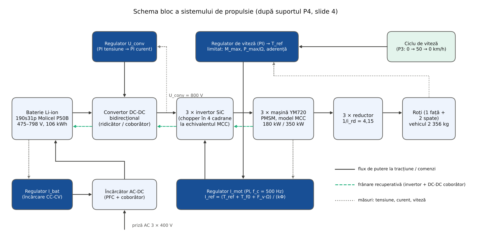
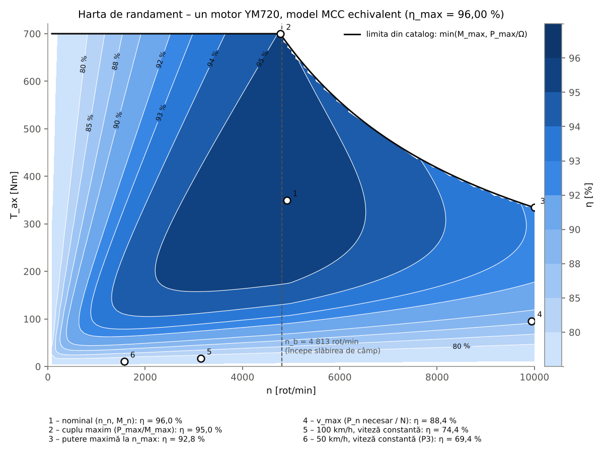
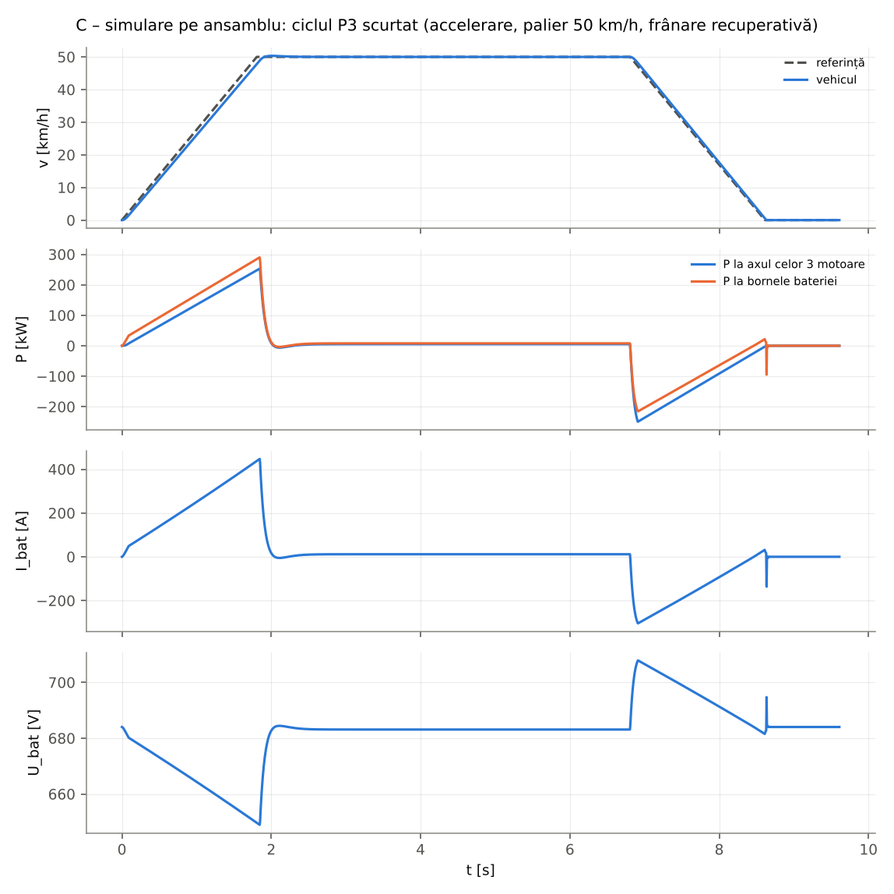
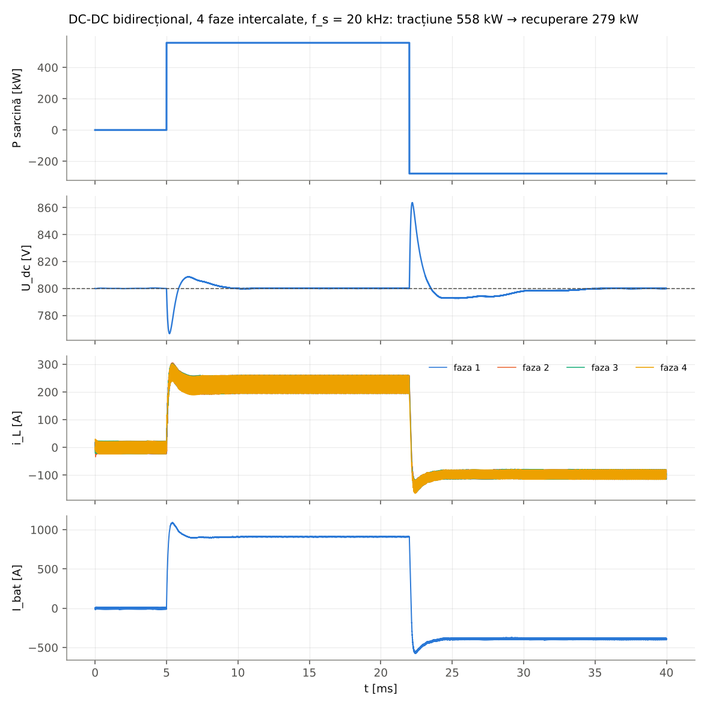

# Proiect CCA – Sistem de propulsie electrică: prezentarea întregului proiect

**Disciplina:** Concepția Asistată de Calculator a Acționărilor Electrice – Proiect (UPB)  
**Vehicul de referință:** Mercedes-AMG GT 63 4MATIC+ 4-Door Coupé (AMG.EA, motoare cu flux axial)  
**Tema:** calculată pentru **vehiculul mediu** al celor 10 vehicule electrice de serie din documentare („se preiau datele medii rezultate din faza de documentare”, suport P4).

Acest document rezumă toate etapele, cu formulele și valorile numerice. Valorile sunt generate automat (`python3 scripts/prezentare_proiect.py`) din aceleași funcții care au fost verificate față de programele Matlab (GNU Octave) – diferențe sub 10⁻⁶. Detaliile sunt în README-ul fiecărei etape.

| Etapă | Suport de curs | Folder |
|---|---|---|
| 1. Documentare | P1 | [`etapa1-documentare`](etapa1-documentare) |
| Calcul 1. Dinamica vehiculului de referință | C1 | [`etapa-calcul-1`](etapa-calcul-1) |
| 2. Puterea mașinii, energia, bateria | P2, P3 | [`etapa2-calcule`](etapa2-calcule) |
| 3. Tema de proiect, modelul MCC, pierderi, hărți de randament, simulări | P4, C3 | [`etapa3-tema-motor`](etapa3-tema-motor) |
| 4. Convertoare DC-DC, încărcarea bateriei | P5-P6 | [`etapa4-convertoare`](etapa4-convertoare) |
| Modelele Simulink (R2023b) | C3 ex. 2, P4–P6 | [`simulink`](simulink) |

## 1. Documentare – datele vehiculelor

| Vehicul | P [kW] | v_max [km/h] | 0–100 [s] | M [kg] | Cuplu [Nm] | Baterie [kWh] | Cx | S [m²] |
|---|---|---|---|---|---|---|---|---|
| Mercedes-AMG GT 63 4MATIC+ 4-Door Coupé | 860 | 300 | 2,40 | 2 460 | 2 000 | 106,0 | 0,220 | 2,44 |
| Porsche Taycan Turbo GT (Weissach) | 760 | 305 | 2,20 | 2 220 | 1 240 | 97,0 | 0,310 | 2,35 |
| Audi RS e-tron GT performance | 680 | 250 | 2,50 | 2 320 | 1 027 | 97,0 | 0,260 | 2,35 |
| Lotus Emeya R | 675 | 256 | 2,78 | 2 565 | 985 | 102,0 | – | – |
| Tesla Model S Plaid | 760 | 322 | 2,10 | 2 178 | 1 420 | 96,0 | 0,208 | – |
| Lucid Air Sapphire | 908 | 330 | 1,96 | 2 420 | 1 940 | 118,0 | – | – |
| Xiaomi SU7 Ultra | 1 138 | 350 | 1,98 | 2 360 | 1 770 | 93,7 | – | – |
| Yangwang U9 | 960 | 309 | 2,36 | 2 475 | 1 680 | 80,0 | – | – |
| Rimac Nevera | 1 408 | 412 | 1,81 | 2 300 | 2 340 | 120,0 | 0,300 | – |
| Maserati GranTurismo Folgore | 560 | 325 | 2,70 | 2 260 | 1 350 | 83,0 | – | – |
| **Vehicul mediu** | **870,9** | **315,9** | **2,24** | **2 355,8** | **1 575,2** | **99,3** | **0,2596** | **2,380** |

Autonomia medie (WLTP): 557,2 km; consumul mediu 21,39 kWh/100 km. Sursele fiecărei valori sunt în registrul etapei 1 (foaia „Surse”) și în etapa 2.

### Calcul 1 – dinamica longitudinală a vehiculului de referință (curs C1)

Analiza separată din [`etapa-calcul-1`](etapa-calcul-1) (relațiile (1)–(50) din C1, pentru GT 63): la 300 km/h sunt necesari 2 582 N la roți și 226,5 kW la motoare (viteza maximă este limitată electronic, nu de putere); accelerarea 0–100 km/h în 2,4 s cere un coeficient de aderență µ ≈ 1,19, deci este limitată de aderență – aceeași concluzie ca în P2 pentru vehiculul mediu.

## 2. P2 – Puterea și cuplul mașinii electrice

Ipoteze (curs): g = 9,81 m/s², ρ = 1,293 kg/m³, µf = 0,013, µa = 0,8, α = 0, Vv = 0, r = 0,35 m, pierderi în reductor P_p = P_ax/100.

| Pas | Relația | Calcul | Rezultat |
|---|---|---|---|
| 2 | a_doc = Va/ta | 27,778 / 2,24 | 12,416 m/s² |
| 3 | Fra = ½·ρ·S·Cx·Va² | ½·1,293·2,380·0,2596·27,778² | 308,2 N |
| 3 | Ff = µf·M·g·cos α | 0,013·2 355,8·9,81 | 300,4 N |
| 3 | Ft = Fra + Ff + Gt + M·a_doc | 308,2 + 300,4 + 0 + 29 248,9 | 29 857,5 N |
| 4 | Fa = µa·M·g | 0,8·2 355,8·9,81 | 18 488,3 N |
| 4 | Ft ≤ Fa ? | 29 858 ≤ 18 488 | **NU** → Ft = Fa, a = 7,590 m/s², ta = 3,66 s |
| 5 | Mr = r·Ft | 0,35·18 488,3 | 6 470,9 Nm |
| 5 | Pr = Mr·Ωr, Ωr = Va/r | 6 470,9·79,37 | 513,56 kW |
| 5 | Pax = Pr/0,99 | | **518,75 kW = P_max** |
| 7 | Ft(v_max) = Fra + Ff | v_max = 87,75 m/s | 3 376,1 N |
| 8 | P(v_max) = Ft·v_max/0,99 | | **299,25 kW = P_n** |

Puterea cerută de accelerare este limitată de aderență: cu a_doc ar fi fost necesari 838 kW (puterea medie declarată 871 kW). Pentru GT 63: P_max = 541,7 kW, P_n = 229,3 kW.

## 3. P3 – Necesarul de energie și bateria

Ciclul: accelerare 0 → V1 = 50 km/h cu a = 7,688 m/s², rulare cu V1, decelerare simetrică; lungimea ciclului = autonomia 557,2 km; η = 0,8; rezervă 30 %.

| Mărime | Relația | Valoare |
|---|---|---|
| t1 | V1/a | 1,8066 s |
| P1 | Ft(V1, a)·V1 | 256,78 kW |
| P_med | (P0 + P1)/2 | 128,39 kW |
| W01 (n = 100) | Σ P_ti·Δt | 233,791 kJ (eroare 1,002 % față de integrala exactă) |
| W01 (n = 1000) | Σ P_ti·Δt | 231,703 kJ (eroare 0,100 % față de integrala exactă) |
| d1 = df | V1·t1/2 | 12,55 m |
| d2, t12 | autonomie − 2·d1; d2/V1 | 557,22 km; 11,14 h |
| P1' (V1 constant) | Ft(V1, 0)·V1 | 5,243 kW |
| W12 | P1'·t12 | 58,43 kWh |
| W_stocată | W01/η + W12/η − η·W2f | 73,07 kWh |
| **W_bat** | W_stocată/(1 − 0,3) | **104,38 kWh** |

**Bateria** (celula Molicel INR-21700-P50B: 3,6 V, 5,0 Ah, 60 A continuu, 12,8 mΩ): Ns = ⌊800/4,2⌋ = 190 în serie, Np = max(energie 31, curent 23) = 31 în paralel → **190s31p**, 5890 celule, 106,02 kWh, 475–798 V (nominal 684 V), celule 418 kg, pachet ≈ 664 kg (28,2 % din M ≤ 30 %: DA).

## 4. P4 – Tema de proiect

Mașina electrică: **3 × YASA YM720** (mașină sincronă cu magneți permanenți, flux axial (răcire cu ulei)), 1 față + 2 spate; descrisă și simulată cu ecuațiile MCC din C3 (echivalentul de curent continuu al motorului comandat vectorial).

| Mărime | Pe motor | Total | Obținută din |
|---|---|---|---|
| P_n | 180 kW | 540 kW | catalog; necesar 299,2 kW (P2) |
| U_n | 800 V | – | circuitul intermediar (DC-DC) |
| I_n | 234,4 A | 703,1 A | P_n/(η_n·U_n), η_n = 0,96 |
| n | 4 911 rot/min (n_max 10 000) | – | n_n = P_n/M_n |
| M_n | 350 Nm | 1 050 Nm | catalog |
| P_max | 350 kW | 1 050 kW | catalog; necesar 518,8 kW (P2) |
| I_max | 463,9 A | 1 391,7 A | (M_max + T_f0 + F_v·Ω_b)/k |
| M_max | 700 Nm | 2 100 Nm | catalog; necesar față 580 Nm, spate 497 Nm/motor |
| Reductor i_rd | 0,2410 (1:4,15) | – | ales: n(v_max) = 9 936 rot/min ≤ n_max |
| Baterie W_bat | 104,38 kWh necesar | 106,02 kWh instalat | P3 |

Cerințele vehiculului: P_rn = 296,3 kW, n_rn = 2 394 rot/min, M_rn = 1 181,6 Nm; P_rmax = 513,6 kW, n_rmax = 2 394 rot/min, M_rmax = 6 470,9 Nm.

**Confirmări:** MCC – N·P_max ≥ P_max (DA), N·P_n ≥ P_n (DA), cuplu pe punți (DA), tensiune (DA); reductor – turație (DA), cuplu la roți 8 628 ≥ 6 471 Nm (DA); baterie – energie (DA), curent pe celulă 44,0 A ≤ 60 A (DA), putere (DA).

## 5. C3 – Modelul MCC echivalent, pierderi, hărți de randament, încălzire

U = E + R_a·I + ΔU_p, E = k·Φ·Ω, T_E = k·Φ·I; P_Fe = K_H·Ω + K_F·Ω², P_fv = T_m0·Ω + F_m·Ω²; T_ax = T_E − T_f0 − F_v·Ω (T_f0 = K_H + T_m0, F_v = K_F + F_m); η = P2/P1.

| Parametru | Valoare | Relația |
|---|---|---|
| P1_n, ΣP_n, I_n | 187,50 kW, 7,50 kW, 234,38 A | P_n/η_n; P1_n − P_n; P1_n/U_n |
| R_a | 0,06827 Ω | 0,50·ΣP_n/I_n² |
| k | 1,52444 Nm/A | (U_n − R_a·I_n)/Ω_n |
| K_H; K_F | 2,7727 Nm; 4,5334·10⁻³ Nm·s | P_Fe(n_n) = 0,35·ΣP_n, P_Fe(n_max) = 3,0·P_Fe(n_n) |
| T_m0; F_m | 0,6699 Nm; 2,9508·10⁻³ Nm·s | P_fv(n_max) = 3,5·P_fv(n_n) |
| T_f0; F_v | 3,4426 Nm; 7,4842·10⁻³ Nm·s | verificare T_ax(n_n) = 350,00 Nm = M_n |
| n_b | 4 813 rot/min | U_n = k·Ω_b + R_a·I_max |
| L_a; J_rotor | 0,546 mH; 0,20 kg·m² | L_a = τ_a·R_a, τ_a = 8 ms (YASA) |
| U_p (pornire) | 31,67 V | R_a·I_max (direct la U_n: I_p = 11 719 A) |

| Punct | n [rot/min] | T_ax [Nm] | P1 [kW] | P_a [kW] | P_Fe [kW] | P_fv [kW] | η [%] |
|---|---|---|---|---|---|---|---|
| nominal (n_n, M_n) | 4 911 | 350,0 | 187,50 | 3,750 | 2,625 | 1,125 | 96,00 |
| cuplu maxim (P_max/M_max) | 4 775 | 700,0 | 368,28 | 14,691 | 2,520 | 1,073 | 95,04 |
| putere maximă la n_max | 10 000 | 334,2 | 376,97 | 15,158 | 7,875 | 3,938 | 92,85 |
| v_max (P_n necesar / N) | 9 936 | 95,9 | 112,79 | 1,357 | 7,793 | 3,892 | 88,44 |
| 100 km/h, viteză constantă | 3 145 | 17,3 | 7,65 | 0,016 | 1,405 | 0,541 | 74,37 |
| 50 km/h, viteză constantă (P3) | 1 573 | 10,7 | 2,54 | 0,007 | 0,580 | 0,190 | 69,44 |

Harta de randament: η_max = 96,00 % la 4 917 rot/min și 347 Nm; η ≥ 95 % pe 23,8 % din domeniu.

Încălzirea (Q = m·c·ΔT, m·c = 16 500 J/K, fără răcire): accelerare 0–100 km/h ΔT = 2,04 K; 30 s la M_max ΔT = 33,2 K; la v_max pierderi 13,04 kW/motor (47,4 K/min fără răcire); la 50 km/h 777 W/motor – puterea de răcire în regim permanent.

## 6. Simulările mașinii și ale ansamblului

| Simulare | Rezultat |
|---|---|
| A – pornire în gol la U_p, treaptă de sarcină M_n | I vârf 283,6 A; Ω gol 20,667 rad/s (teoretic 20,669); cu sarcină 10,390 rad/s, 231,9 A (teoretic 10,390 rad/s, 231,9 A) |
| B – accelerare cu regulator de curent și slăbire de câmp | 0–100 km/h 3,72 s (P2: 3,66 s), 0–200 km/h 7,56 s, v_max în 14,2 s |
| D – rampă de tensiune cu sarcina vehiculului | I vârf 463,9 A, n final 7 584 rot/min |
| C – ansamblu pe ciclul P3 scurtat (baterie → DC-DC → invertoare → motoare → roți) | eroare de viteză ≤ 2,16 km/h; η lanț: accelerare 0,774, palier 0,735, recuperare 0,764; I_bat -304 … 447 A; energie din baterie 168,4 kJ (P3: 136,9 kJ) |

## 7. P5-P6 – Convertoarele și încărcarea bateriei

| Bloc | Calcul | Simulare cu comutație |
|---|---|---|
| DC-DC bidirecțional, 4 faze, 20 kHz, Wolfspeed CAB760M12HM3 (semipunte SiC 1200 V) | P = 558 kW; D = 1 − U_bat/U_dc = 0,0025…0,406; I_bat max 1 198 A; L = U_bat·D/(ΔI·f_s) = 107,4 µH/fază; C ≥ 1 770 µF; pierderi 2,59 kW | tracțiune: D = 0,2344 (teoretic 0,2342), ΔI faza 68,1 A (formula 66,8), ΔI_bat 10,4 A (intercalare); recuperare -391 A; U_dc 767…864 V la trepte |
| Chopper în punte H (invertorul echivalent), 10 kHz | ΔI = U_dc/(8·L_a·f) = 18,3 A (3,9 % din I_max) | în modelul Simulink de ansamblu |
| Încărcător 22 kW: PFC 880 V + coborâtor cu histerezis | CC 26,75 A (0,17C) până la 798 V, CV până la 1,55 A; L = 605 µH (h = 8,0 A); 10 → 100 %: 5,31 h | trecerea CC → CV la 20,6 ms (mediu: 20 ms, timp scalat), oprire la 74,9 ms (74,7) |

Încărcarea completă (model mediu): CC 5,16 h, total 5,31 h; din rețea 100,22 kWh, stocat 96,94 kWh.

## 8. Modelele Simulink (MATLAB R2023b)

În folderul [`simulink`](simulink), `ruleaza_simulink` construiește automat, simulează și compară cu calculele Matlab șase modele: modelul MCC din C3 cu blocuri Simulink (scenariile A și D), mașina ca bloc **DC Machine** (Specialized Power Systems, ca în exemplul de curs), DC-DC-ul bidirecțional cu 4 faze, încărcătorul CC-CV cu histerezis și sistemul complet (baterie → DC-DC → punte H → DC Machine + vehicul, pe ciclul P3). Fișierele `.slx` rezultate se deschid și se modifică normal în Simulink.

## 9. Concluzii

1. Vehiculul mediu (2 356 kg) cere P_max = 519 kW la ax (limitat de aderență, 0–100 km/h în 3,66 s) și P_n = 299 kW la v_max = 316 km/h.
2. Bateria 190s31p cu celule Molicel P50B (106,0 kWh) acoperă energia P3 (104,4 kWh cu rezerva de 30 %) și curentul de vârf (44,0 A/celulă).
3. Cele 3 motoare YASA YM720 (1:4,15) confirmă tema cu rezervă de putere; modelul MCC echivalent are η_max = 96,0 % și reproduce 0–100 km/h în 3,72 s.
4. DC-DC-ul bidirecțional cu 4 faze SiC (L = 107 µH/fază, C ≈ 1,8 mF) menține 800 V la tracțiune și recuperare; încărcătorul de 22 kW încarcă bateria în 5,3 h.
5. La viteză constantă mică randamentul lanțului scade (3 motoare mari pentru câțiva kW): η = 0,8 din P3 este optimist pe palierul de 50 km/h, dar rezerva de 30 % a bateriei acoperă diferența; folosirea unui singur motor la viteză constantă ar crește randamentul.

