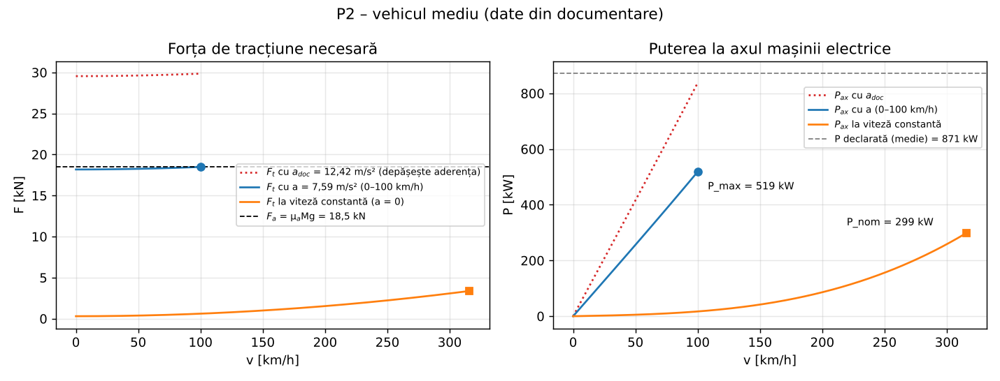
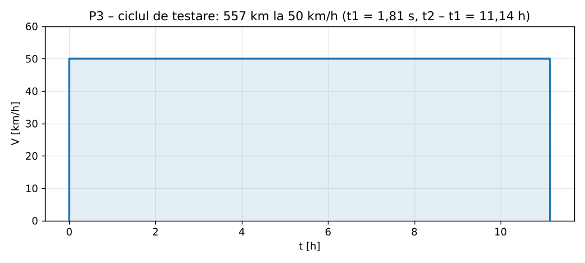
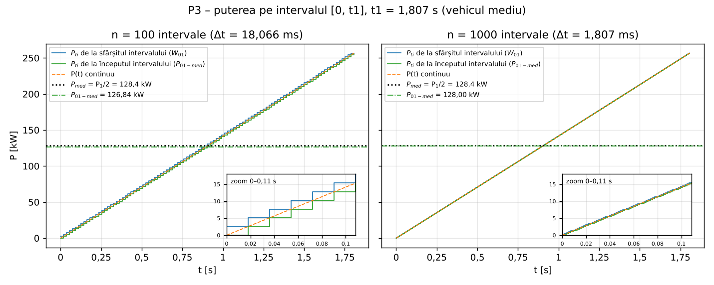

# Etapa 2 – Calcule de dimensionare (Proiect P2 și P3)

Calculele cerute în suporturile **CCA – Proiect P2** (07.10.2026) și **CCA – Proiect P3** (14.10.2026):

- **P2** – prelucrarea datelor din documentare (transformare în S.I.), forțele rezistente pe vehicul și
  **puterea maximă / nominală a mașinii electrice**, cu reductorul și cuplul la ax;
- **P3** – **necesarul de energie electrică** pentru un ciclu accelerare – 50 km/h constant – decelerare a cărui
  lungime este autonomia cerută (inclusiv exercițiile Matlab cu n = 100 și n = 1000 de pași) și **calculul bateriei**
  cu celule Li-ion.

Conform suportului („se preiau datele medii rezultate din faza de documentare”), tema se calculează pentru
**vehiculul mediu** al celor 10 vehicule de serie din tabelul etapei 1. Același calcul este făcut și pentru vehiculul
de referință **Mercedes-AMG GT 63 4MATIC+ 4-Door Coupé**, pentru comparație.

## Fișiere

| Fișier | Conținut |
|---|---|
| [`CCA_Etapa2_Calcule.xlsx`](CCA_Etapa2_Calcule.xlsx) | Toate calculele ca formule Excel: Date documentare, Sinteză, Ipoteze, P2 Putere, P3 Energie, P3 n=100, P3 n=1000, Baterie, Surse |
| [`matlab/`](matlab) | Programul Matlab: `main_p2.m`, `main_p3.m` (afișează pașii și trasează graficele), `ruleaza_tot.m`, funcțiile de calcul |
| [`date/date_documentare.csv`](date/date_documentare.csv) | Datele de intrare din documentare (o linie pe vehicul) |
| [`date/celula_aleasa.json`](date/celula_aleasa.json) | Parametrii celulei Li-ion alese (Molicel INR-21700-P50B) |
| [`date/motoare_catalog.json`](date/motoare_catalog.json) | Motoare de tracțiune din cataloage, pentru comparația cu mașina calculată |
| [`python/calcule_p2_p3.py`](python/calcule_p2_p3.py) | A doua implementare (verificare); generează registrul Excel, figurile și tabelele din acest README |
| [`figuri/`](figuri) | Graficele P2 și P3 |
| [`rezultate/`](rezultate) | Rezultatele numerice (JSON) din Matlab/Octave și din Python |

**Rulare Matlab:** din folderul `matlab/` se execută `main_p2` și apoi `main_p3`; ele afișează toți pașii și desenează
figurile (P(t) pentru n = 100 și n = 1000 este în `main_p3`). `ruleaza_tot` rulează ambele **fără figuri** și salvează
`rezultate/rezultate_matlab.json`; pentru figuri: `GRAFICE = true; ruleaza_tot`. Fișierele `.m` sunt în UTF-8
(Matlab R2020a sau mai nou) și funcționează și în GNU Octave 8.
**Rulare Python:** `python3 etapa2-calcule/python/calcule_p2_p3.py` (numpy, matplotlib, openpyxl).

**Verificare:** aceleași calcule sunt făcute în trei moduri independente – Matlab (rulat în Octave 8.4), Python și
formulele din Excel (recalculate cu LibreOffice). Toate mărimile comparate coincid (eroare relativă < 10⁻⁶), iar registrul
nu are erori de formulă. Calculele au fost verificate și independent, pas cu pas, față de suporturile P2 și P3.

## Ipoteze de calcul

| Mărime | Valoare | Justificare |
|---|---|---|
| g | 9,81 m/s² | valoare uzuală (g_n = 9,806 65 m/s²) |
| ρ (densitatea aerului) | 1,293 kg/m³ | „condiții normale” (0 °C, 101 325 Pa): ρ = p/(R·T) = 101 325/(287,05 · 273,15); la 15 °C (atmosfera standard ISA) ρ = 1,225 kg/m³ – vezi sensibilitatea |
| µf (frecare la rulare) | 0,013 | exemplul din curs; relația f = 0,01·(1 + V/160) (Ehsani) dă 0,013 la 50 km/h |
| µa (aderență) | 0,8 | exemplul din curs; corespunde asfaltului uscat la ≈ 90 km/h (0,85 la 50 km/h); anvelopele bune ajung pe asfalt uscat la 1,0–1,2 – vezi sensibilitatea |
| α, Vv | 0, 0 | drum drept, fără vânt (simplificările din curs) |
| r (raza dinamică a roții) | 0,35 m | media razelor anvelopelor spate (GT 63 295/40 R20, Porsche 305/30 R21, Audi 285/40 R20, Lucid 295/30 R21, Rimac 315/35 R20) este 0,364 m; raza dinamică ≈ 0,97 · 0,364 ≈ 0,35 m (și exemplul „35 cm” din curs) |
| Pp (pierderi în reductor) | Pax / 100 | curs (P2, slide 7) |
| Va | 100 km/h | punct pe rampa de accelerare: sfârșitul probei 0–100 km/h din documentare |
| n_max (turația maximă a mașinii la v_max) | 15 000 rot/min | alegere de proiectare; motoarele clasei: GT 63 > 13 000 rot/min (spate) / > 15 000 rot/min (față), Xiaomi V8s 27 200 rot/min |
| V1, η, rezervă | 50 km/h, 80 %, 30 % | curs (P3); η = 80 % corespunde pierderilor de 15–20 % ale acționării electrice pe ciclurile de omologare |
| U_bat | ≈ 800 V | arhitectura de 800 V a clasei de vehicule |
| Masa bateriei | ≤ 30 % din M | curs (P3, slide 9) |

## P2 – Datele din documentare

Datele de intrare ale fiecărui vehicul (etapa 1, completate cu autonomia și consumul; sursele sunt în foaia „Surse”):

<!-- AUTO:vehicule -->
| Vehicul | P [kW] | v_max [km/h] | a 0–100 [m/s²] | M [kg] | Cuplu [Nm] | Baterie [kWh] | Autonomie [km] | Consum [kWh/100 km] | Cx | S [m²] |
|---|---|---|---|---|---|---|---|---|---|---|
| Mercedes-AMG GT 63 4MATIC+ 4-Door Coupé | 860 | 300 | 11,57 | 2 460 | 2 000 | 106,0 | 646,0 WLTP | 19,45 | 0,220 | 2,44 |
| Porsche Taycan Turbo GT (Weissach) | 760 | 305 | 12,63 | 2 220 | 1 240 | 97,0 | 546,5 WLTP | 20,95 | 0,310 | 2,35 |
| Audi RS e-tron GT performance | 680 | 250 | 11,11 | 2 320 | 1 027 | 97,0 | 562,5 WLTP | 19,75 | 0,260 | 2,35 |
| Lotus Emeya R | 675 | 256 | 9,99 | 2 565 | 985 | 102,0 | 460,0 WLTP | – | – | – |
| Tesla Model S Plaid | 760 | 322 | 13,23 | 2 178 | 1 420 | 96,0 | 605,5 WLTP | 18,35 | 0,208 | – |
| Lucid Air Sapphire | 908 | 330 | 14,19 | 2 420 | 1 940 | 118,0 | 694,0 WLTP | 19,10 | – | – |
| Xiaomi SU7 Ultra | 1 138 | 350 | 14,03 | 2 360 | 1 770 | 93,7 | 592,5 CLTC | 16,50 | – | – |
| Yangwang U9 | 960 | 309 | 11,77 | 2 475 | 1 680 | 80,0 | 450,0 CLTC | – | – | – |
| Rimac Nevera | 1 408 | 412 | 15,35 | 2 300 | 2 340 | 120,0 | 489,0 WLTP | 30,00 | 0,300 | – |
| Maserati GranTurismo Folgore | 560 | 325 | 10,29 | 2 260 | 1 350 | 83,0 | 454,5 WLTP | 22,10 | – | – |
| **Medie** | **870,9** | **315,9** | **12,42** | **2 355,8** | **1 575,2** | **99,3** | **557,2** (WLTP) | **21,39** (WLTP) | **0,2596** | **2,380** |
<!-- /AUTO:vehicule -->

- Accelerația fiecărui vehicul este a = v / t pentru 0–100 km/h (Lucid: 0–60 mph = 96,56 km/h). Media accelerațiilor
  dă timpul echivalent 0–100 km/h.
- **Timpii 0–100 km/h nu sunt măsurați la fel:** Rimac declară explicit un timp cu „1-foot rollout” (primii 30,48 cm nu
  se cronometrează), iar timpii Tesla și Lucid sunt după convenția americană, care folosește de regulă același rollout.
  Pentru GT 63 s-a folosit valoarea standard (2,4 s; cu rollout 2,1 s). Accelerația medie din documentare este deci
  ușor optimistă.
- **Autonomia și consumul se mediază doar pe valorile WLTP.** Xiaomi și Yangwang declară ciclul chinezesc CLTC, mai lent
  decât WLTP (viteză medie ≈ 29 km/h și maximă 114 km/h, față de ≈ 46,5 km/h și 131 km/h la WLTP), deci cu autonomii mai
  mari. Lotus nu publică un consum WLTP separat pentru Emeya R.
- Cx și S sunt mediate pe valorile publicate (5, respectiv 3 vehicule).

Transformarea în unități S.I. (slide 2):

<!-- AUTO:date_si -->
| Mărime | Vehicul mediu (unitatea din documentare) | Vehicul mediu (S.I.) | GT 63 (S.I.) |
|---|---|---|---|
| Putere maximă | 870,9 kW | 870 900 W | 860 000 W |
| Viteză maximă | 315,9 km/h | 87,750 m/s | 83,333 m/s |
| Accelerație maximă (medie 0–100 km/h) | 0–100 km/h în 2,24 s | 12,416 m/s² | 11,574 m/s² |
| Autonomie | 557,2 km | 557 250 m | 646 000 m |
| Masă | 2 355,8 kg | 2 355,8 kg | 2 460 kg |
| Capacitate baterie | 99,27 kWh | 357 372 000 Ws | 381 600 000 Ws |
| Cuplu | 1 575,2 Nm | 1 575,2 Nm | 2 000 Nm |
| Consum mediu | 21,39 kWh/100 km | 769,9 Ws/m | 700,2 Ws/m |
| Cx | 0,2596 | 0,2596 | 0,22 |
| Suprafață frontală S | 2,380 m² | 2,380 m² | 2,44 m² |
<!-- /AUTO:date_si -->

## P2 – Puterea mașinii electrice (pașii 1–9)

Se calculează succesiv Ft → Mr → Pr → Pax: întâi în punctul (Va, ta) de pe rampa de accelerare (Va = 100 km/h,
sfârșitul probei 0–100 km/h) – puterea maximă – apoi la v_max constantă, cu a = 0 – puterea nominală.

<!-- AUTO:p2 -->
| Pas | Mărime | Unitate | Vehicul mediu | GT 63 |
|---|---|---|---|---|
| 2 | a_doc = Va / ta | m/s² | 12,416 | 11,574 |
| 3 | Fra(Va) | N | 308,2 | 267,8 |
| 3 | Ff | N | 300,4 | 313,7 |
| 3 | Gt (α = 0) | N | 0,0 | 0,0 |
| 3 | Ft = Fra + Ff + Gt + M·a_doc | N | 29 857,5 | 29 053,7 |
| 4 | Fa = µa·M·g | N | 18 488,3 | 19 306,1 |
| 4 | µ necesar = Ft / (M·g) | - | 1,292 | 1,204 |
| 4 | Ft ≤ Fa ? |  | NU | NU |
| 4 | a realizabil (Ft = Fa) | m/s² | 7,590 | 7,612 |
| 4 | ta realizabil (0–100 km/h) | s | 3,66 | 3,65 |
| 5 | Mr = r·Ft | Nm | 6 470,9 | 6 757,1 |
| 5 | Ωr = Va / r | rad/s | 79,37 | 79,37 |
| 5 | Pr = Mr·Ωr | kW | 513,56 | 536,28 |
| 5 | Pax = Pr / 0,99 | kW | 518,75 | 541,70 |
| 5 | Pp = Pax / 100 | kW | 5,19 | 5,42 |
| 6 | i_rd = Ωr / Ωax (n_max = 15 000 rot/min) | - | 0,1596 | 0,1516 |
| 6 | 1 / i_rd | - | 6,27 | 6,60 |
| 6 | n_ax la Va (turația de bază) | rot/min | 4 748 | 5 000 |
| 6 | Max = Pax / Ωax | Nm | 1 043,3 | 1 034,6 |
| 7 | Fra(v_max) | N | 3 075,7 | 2 410,0 |
| 7 | Ft(v_max) = Fra + Ff + Gt | N | 3 376,1 | 2 723,7 |
| 8 | Ft(v_max) ≤ Fa ? |  | DA | DA |
| 8 | Pax la v_max | kW | 299,25 | 229,27 |
| 8 | Max la v_max | Nm | 190,5 | 146,0 |
| 9 | **P_max (puterea maximă)** | kW | **518,8** | **541,7** |
| 9 | **P_nom (puterea nominală)** | kW | **299,2** | **229,3** |
| – | Pax cu a_doc, fără limita de aderență | kW | 837,8 | 815,2 |
| – | Puterea declarată (documentare) | kW | 870,9 | 860,0 |
| – | Max cu a_doc, fără limita de aderență | Nm | 1 684,8 | 1 556,9 |
| – | Cuplul declarat (documentare) | Nm | 1 575,2 | 2 000,0 |
<!-- /AUTO:p2 -->

**Observații P2**

1. **Aderența nu este respectată cu accelerația din documentare.** Media vehiculelor de serie face 0–100 km/h în
   ≈ 2,24 s (a ≈ 12,4 m/s²), ceea ce cere un coeficient de aderență µ ≈ 1,29; cu µa = 0,8 se poate transmite cel mult
   a ≈ 7,6 m/s². Conform pasului 4 s-a luat Ft = Fa și s-a recalculat accelerația: 0–100 km/h în ≈ 3,66 s. Diferența
   față de vehiculele reale are două cauze: anvelopele de performanță pe asfalt uscat (µ ≈ 1,0–1,2, față de 0,8) și
   timpii măsurați cu „1-foot rollout”. Tracțiunea integrală nu este o cauză: relația Fa = µa·M·g presupune deja că
   toată greutatea vehiculului este pe roți motoare.
2. **Verificarea coerenței:** cu accelerația din documentare (fără limita de aderență), aceleași formule dau
   Pax ≈ 838 kW față de puterea declarată de 870,9 kW (diferență ≈ 4 %) și Max ≈ 1 685 Nm față de cuplul declarat de
   1 575 Nm (≈ 7 %). Datele din documentare sunt deci coerente între ele. Diferența dintre puterea declarată și
   P_max calculată (≈ 519 kW), respectiv dintre cuplul declarat și Max (≈ 1 043 Nm), provine aproape în întregime din
   limitarea de aderență (µa = 0,8).
3. **Puterea nominală** (rulare cu v_max) este dominată de rezistența aerodinamică: Fra(v_max) ≈ 91 % din Ft. Aderența
   este respectată la v_max cu o rezervă mare (Ft ≈ 3,4 kN față de Fa ≈ 18,5 kN).
4. **Reductorul:** cu n_max = 15 000 rot/min la v_max rezultă i_rd ≈ 0,16, adică 1/i_rd ≈ 6,3, apropiat de valorile
   reale ale clasei (Lucid Air Sapphire: 1/i_rd = 7 față / 6,8 spate). Turația de bază (la Va) este ≈ 4 750 rot/min,
   deci mașina trebuie să lucreze la putere constantă pe un domeniu de turație ≈ 3,2 : 1 (slăbire de câmp).
5. Cuplul și puterea calculate sunt pentru tot vehiculul; repartizarea pe 2–4 motoare (față / spate) se face la schema
   acționării (etapa 4).

Sensibilitatea față de µa și ρ (vehicul mediu):

<!-- AUTO:sensibilitate -->
| µa | ρ [kg/m³] | a [m/s²] | ta 0–100 [s] | P_max [kW] | P_nom [kW] |
|---|---|---|---|---|---|
| 0,8 | 1,293 | 7,59 | 3,66 | 518,8 | 299,2 |
| 0,8 | 1,225 | 7,60 | 3,66 | 518,8 | 284,9 |
| 1,0 | 1,293 | 9,55 | 2,91 | 648,4 | 299,2 |
| 1,0 | 1,225 | 9,56 | 2,91 | 648,4 | 284,9 |
| 1,2 | 1,293 | 11,51 | 2,41 | 778,1 | 299,2 |
| 1,2 | 1,225 | 11,52 | 2,41 | 778,1 | 284,9 |
<!-- /AUTO:sensibilitate -->

Accelerația din documentare ar cere µ ≈ 1,29 (vehicul mediu), respectiv ≈ 1,20 (GT 63); cu µa = 1,2 calculul se
apropie de valorile reale ale clasei. Densitatea aerului influențează practic numai puterea nominală: P_max nu depinde
de ρ (Ft = Fa), iar accelerația se modifică cu sub 0,2 %.

## P2 – Tipul mașinii electrice, convertorul și comparația cu cataloage

Suportul P2 tratează două variante: **MCC** (mașină de curent continuu, alimentată printr-un convertor DC-DC) și
**MCA** (mașină de curent alternativ, alimentată printr-un invertor, cu tensiunea Um și frecvența fm). Toate vehiculele
din documentare folosesc **mașini sincrone cu magneți permanenți** (MCA), de aceea tema folosește varianta MCA:

- **convertorul** este un invertor trifazat DC–AC (tranzistoare SiC, ca la vehiculele clasei), alimentat direct din
  bateria de 555–932 V;
- **tensiunea de alimentare a motorului**: cu modulație vectorială, tensiunea de linie maximă (valoare efectivă) este
  Um ≈ U_bat / √2, adică ≈ 392 V la bateria descărcată și ≈ 565 V la tensiunea nominală;
- **frecvența de alimentare** este fm = p · n / 60 (p = numărul de perechi de poli): de exemplu, cu p = 4, fm = 1 000 Hz
  la n_max = 15 000 rot/min și ≈ 317 Hz la turația de bază.

„Parametrii MCC sau MCA rezultă din datele de catalog furnizor” (P2, slide 7). Comparația cu motoare de tracțiune
din cataloage (valori de vârf / continue din fișele producătorilor):

<!-- AUTO:motoare -->
<!-- /AUTO:motoare -->

## P3 – Necesarul de energie electrică (pașii 1–14)

Ciclul de testare: accelerare până la V1 = 50 km/h, rulare cu V1 constantă, decelerare simetrică (df = d1). Lungimea
totală a ciclului este autonomia medie din documentare. Accelerația pornește, ca în suport, de la a = Va/ta din
sesiunea precedentă (P2, pasul 2); la pasul 4 aderența nu este respectată nici la V1, deci se ia Ft1 = Fa și se
recalculează a (≈ 7,69 m/s²; la 50 km/h rezistența aerodinamică este mai mică decât la 100 km/h, de aceea a este puțin
mai mare decât în P2).

<!-- AUTO:p3 -->
| Pas | Mărime | Unitate | Vehicul mediu | GT 63 |
|---|---|---|---|---|
| 1 | V1 | m/s | 13,8889 | 13,8889 |
| 2 | a = Va/ta (din P2) | m/s² | 12,416 | 11,574 |
| 4 | Ft1 ≤ Fa cu a din P2 ? |  | NU | NU |
| 4 | a folosit (Ft1 = Fa dacă aderența nu e respectată) | m/s² | 7,688 | 7,693 |
| 3 | Ft1 = Fra + Ff + Gt + M·a | N | 18 488,3 | 19 306,1 |
| 3 | P1 = Ft1·V1 | kW | 256,782 | 268,140 |
| 5 | Ft1' = Fra + Ff + Gt | N | 377,49 | 380,67 |
| 5 | P1' = Ft1'·V1 | kW | 5,2429 | 5,2871 |
| 6 | t1 = V1 / a | s | 1,8066 | 1,8053 |
| 7 | Pmed = P1 / 2 | kW | 128,391 | 134,070 |
| 7 | P01-med (n = 1000, începutul intervalelor) | kW | 127,995 | 133,703 |
| 8 | Wmed = Pmed·t1 | kJ | 231,954 | 242,041 |
| 8 | W01-med = P01-med·t1 (n = 1000) | kJ | 231,239 | 241,379 |
| 8 | W01 = Σ Pti·Δti (n = 1000, sfârșitul intervalelor) | kJ | 231,703 | 241,863 |
| 8 | W01 exact (integrală) | kJ | 231,471 | 241,621 |
| 9 | d1 = df = V1·t1 / 2 | m | 12,546 | 12,537 |
| 10 | autonomie = d1 + d2 + df | km | 557,2 | 646,0 |
| 10 | d2 | km | 557,225 | 645,975 |
| 10 | t2 − t1 = d2 / V1 | h | 11,144 | 12,919 |
| 11 | W12 = P1'·(t2 − t1) | kWh | 58,429 | 68,306 |
| 12 | Wmec = W01 + W12 − W2f | kWh | 58,429 | 68,306 |
| 13 | Wstocată = W01/η + W12/η − η·W2f | kWh | 73,066 | 85,413 |
| 14 | Wbat = Wstocată / (1 − 0,30) | kWh | 104,38 | 122,02 |
| – | consum echivalent (Wstocată / autonomie) | kWh/100 km | 13,11 | 13,22 |
| – | consum mediu din documentare | kWh/100 km | 21,39 | 19,45 |
| – | baterie din documentare | kWh | 99,3 | 106,0 |
<!-- /AUTO:p3 -->

**Exercițiile Matlab – discretizarea intervalului [0, t1]** (vehicul mediu). Grila are n + 1 puncte,
t_i = (i − 1)·Δt, i = 1 … n + 1 (indicii din curs coincid cu cei din Matlab). Pe fiecare interval forța Fti și viteza
Vti sunt constante:

- P01-med = (1/n)·Σ(i = 1…n) Fti·Vti folosește valorile de la **începutul** intervalelor ⇒ W01-med = P01-med·t1
  **subestimează** energia;
- W01 = Σ(i = 1…n+1) Pti·Δt, cu P(t_1) = 0, folosește valorile de la **sfârșitul** intervalelor ⇒ W01 **supraestimează**
  energia.

<!-- AUTO:discretizare -->
| n | Δt [ms] | P01-med [kW] | W01-med [kJ] (eroare) | W01 [kJ] (eroare) | timp Octave [µs] | timp Python [µs] |
|---|---|---|---|---|---|---|
| 100 | 18,066 | 126,840 | 229,151 (−1,002 %) | 233,791 (+1,002 %) | 169 | 33 |
| 1000 | 1,807 | 127,995 | 231,239 (−0,100 %) | 231,703 (+0,100 %) | 157 | 47 |
| exact | – | 128,124 | 231,471 | 231,471 | – | – |
| Pmed = P1/2 | – | 128,391 | Wmed = 231,954 (+0,209 %) | – | – | – |
<!-- /AUTO:discretizare -->

**Observații P3**

1. **Precizie față de efortul de calcul:** cele două sume încadrează integrala exactă, iar eroarea lor este
   proporțională cu Δt: de 10 ori mai mulți pași dau o eroare de 10 ori mai mică (± 1 % → ± 0,1 %). Timpul de calcul
   crește mult mai puțin decât de 10 ori, pentru că la n ≤ 1 000 domină timpul fix al apelurilor (crearea vectorilor,
   apelul funcției de forțe), nu operațiile aritmetice. Timpii depind de calculator; în Matlab vor fi diferiți de cei
   din Octave.
2. Aproximarea Pmed = P1/2 presupune P(t) liniar; termenul aerodinamic crește cu t³, deci Wmed supraestimează puțin
   integrala exactă (≈ 0,2 %). Media celor două sume discrete (regula trapezului) este și mai precisă. La 50 km/h energia
   de accelerare W01 este oricum neglijabilă față de W12.
3. Pe slide-ul 7, relația „t2 − t1 = V1/d2” trebuie citită **t2 − t1 = d2 / V1** (timp = distanță / viteză).
4. Wmec = W12, pentru că W01 = W2f. În energia stocată, pe lângă W12/η, ciclul accelerare – frânare recuperativă adaugă
   doar pierderea W01/η − η·W01 = 0,45·W01.
5. **Coerența cu documentarea:** energia necesară în baterie (cu rezerva de 30 %) rezultă apropiată de capacitatea medie
   a bateriilor din documentare. Consumul ciclului (≈ 13 kWh/100 km) este însă mult mai mic decât consumul WLTP mediu
   (≈ 21 kWh/100 km): la 50 km/h rezistența aerodinamică este mică, ciclul WLTP are porțiuni de până la ≈ 130 km/h, iar
   consumul WLTP include pierderile la încărcare și consumatorii auxiliari. Rezerva de 30 % compensează în mare parte
   această diferență.

## P3 – Calculul bateriei electrice

Celula aleasă: **Molicel INR-21700-P50B** (fișa tehnică oficială v1.1): 3,6 V nominal (2,5–4,2 V), 5,0 Ah, 18 Wh,
71 g, 60 A descărcare continuă, rezistență internă DC 12,8 mΩ; producătorul o recomandă pentru „Hyper EVs & Racing
Sports Cars”.

- celulele **în serie** dau tensiunea: Ns = round(800 V / 3,6 V) = 222 ⇒ U = 799 V (555–932 V);
- celulele **în paralel** dau curentul și capacitatea: Np = max(Np din energie, Np din curent);
- curentul cel mai mare apare la tensiunea minimă (baterie aproape descărcată): I = P_max / (η · U_min), unde
  P_max este puterea maximă la ax din P2 și η = 80 %.

<!-- AUTO:baterie -->
| Mărime | Vehicul mediu | GT 63 |
|---|---|---|
| Energia necesară Wbat | 104,38 kWh | 122,02 kWh |
| W_celulă = Cap·U | 64 800 Ws (18,0 Wh) | idem |
| N_min = Wbat / W_celulă | 5 799 | 6 779 |
| Celule în serie Ns (U ≈ 800 V) | 222 | 222 |
| Tensiune nominală (min – max) | 799,2 V (555 – 932 V) | 799,2 V |
| Ramuri în paralel: din energie / din curent | 27 / 20 | 31 / 21 |
| **Configurație** | **222s27p = 5 994 celule** | **222s31p = 6 882 celule** |
| Energie instalată / capacitate | 107,89 kWh / 135 Ah | 123,88 kWh / 155 Ah |
| Curentul bateriei la P_max: la U_nom / la U_min | 811 A / 1 168 A | 847 A / 1 220 A |
| Curent pe celulă la P_max și U_min (max. 60 A) | 43,3 A | 39,4 A |
| Curent pe celulă la puterea declarată: U_nom / U_min | 50,4 A / 72,6 A | 43,4 A / 62,5 A |
| Masa celulelor | 425,6 kg (18,1 % din M) | 488,6 kg (19,9 %) |
| Masa estimată a pachetului (celule / 0,63) | 675,5 kg (28,7 %) | 775,6 kg (31,5 %) |
| Limita 30 % din M | 706,7 kg – respectată | 738,0 kg – DEPĂȘITĂ |
<!-- /AUTO:baterie -->

- **Np este impus de energie** (27 de ramuri pentru vehiculul mediu), nu de curent (20 de ramuri la 60 A). De aceea
  celulele de 5 Ah cu 45 A (Samsung SDI 50S) ar da aceeași configurație 222s27p, iar Molicel P45B (4,5 Ah) ar cere
  ≈ 30 de ramuri din cauza capacității mai mici. P50B a fost aleasă pentru rezerva de curent (≈ 43 A/celulă din 60 A
  admiși, chiar la tensiunea minimă) și pentru rezistența internă publicată.
- **Puterea declarată a clasei (≈ 871 kW)** ar cere ≈ 50 A/celulă la tensiunea nominală, dar ≈ 73 A/celulă la
  tensiunea minimă – peste limita de 60 A. Bateria dimensionată pentru P_max calculat nu poate livra puterea de vârf
  declarată când este aproape descărcată; vehiculele reale limitează și ele puterea la stare de încărcare scăzută.
- **Masa:** celulele cântăresc ≈ 18 % din masa vehiculului. Masa pachetului (celule + carcasă, răcire, BMS, conexiuni) se
  estimează împărțind masa celulelor la raportul celule/pachet: mediana pachetelor NMC actuale este ≈ 0,63 (intervalul
  tipic pentru celule cilindrice 0,55–0,70). Cu 0,63, pachetul vehiculului mediu are ≈ 29 % din masa vehiculului –
  **limita de 30 % este respectată, dar la limită**; cu un raport de 0,60 ar fi depășită. Pentru GT 63 (122 kWh
  necesari) pachetul ar avea ≈ 31,5 % din masă, peste limită – bateria reală a GT 63 are 106 kWh net.

## Sinteză – date pentru proiectare

<!-- AUTO:sinteza -->
| Subsistem | Mărime | Vehicul mediu (temă) | GT 63 (comparație) |
|---|---|---|---|
| Mașina electrică | Tip | MCA – mașină sincronă cu magneți permanenți (PMSM) | idem |
| | Puterea maximă / nominală | 519 kW / 299 kW | 542 kW / 229 kW |
| | Cuplul maxim la ax | 1 043 Nm | 1 035 Nm |
| | Turația de bază / maximă | 4 748 / 15 000 rot/min | 5 000 / 15 000 rot/min |
| Reductor | i_rd = Ωr/Ωax; n_motor/n_roată = 1/i_rd | 0,1596; 6,27 | 0,1516; 6,60 |
| Vehicul | a realizabil / 0–100 km/h | 7,59 m/s² / 3,66 s | 7,61 m/s² / 3,65 s |
| Baterie | Energie necesară / instalată | 104,4 / 107,9 kWh | 122,0 / 123,9 kWh |
| | Celule Molicel P50B | 222s27p = 5 994 | 222s31p = 6 882 |
| | Tensiune nominală (min – max) | 799 V (555 – 932 V) | idem |
| | Masa celulelor / pachetului (estimare) | 426 / 676 kg | 489 / 776 kg |
| Convertor / invertor | Tip | invertor trifazat DC–AC (tranzistoare SiC), alimentat direct din baterie | idem |
| | Tensiunea continuă de intrare U_bat | 555 – 932 V | idem |
| | Tensiunea de linie maximă Um = U_bat/√2 (la U_min / U_nom) | 392 / 565 V | idem |
| | Curentul din baterie la P_max (U_nom / U_min) | 811 / 1 168 A | 847 / 1 220 A |
<!-- /AUTO:sinteza -->

## Legătura cu calculul de dinamică din `etapa-calcul-1`

Folderul [`../etapa-calcul-1`](../etapa-calcul-1/README.md) calculează dinamica longitudinală a GT 63 cu relațiile din
cursul C1 și cu alte ipoteze: masa UE cu șofer (2 535 kg), ρ = 1,225 kg/m³, f = 0,012, µ = 0,85 / 1,20, r = 0,345 m,
randamentul transmisiei 0,95. Aici se folosesc exemplele din suporturile P2/P3 (masa DIN de 2 460 kg din tabelul etapei
1, ρ = 1,293 kg/m³, µf = 0,013, µa = 0,8, r = 0,35 m, Pp = 1 %), de aceea valorile diferă puțin. Concluziile coincid:
accelerarea din datele oficiale cere µ ≈ 1,2 (este limitată de aderență), iar la v_max puterea necesară (≈ 230 kW la
GT 63) este mult sub puterea continuă de 530 kW.

## Observații pentru etapele următoare

- **Etapa 4 (schema acționării):** puterea și cuplul de mai sus se împart pe motoare (de exemplu 1 față + 2 spate, ca la
  GT 63). Invertorul trebuie să funcționeze pe tot domeniul de tensiune al bateriei, de la 555 V (descărcată) la 932 V
  (încărcată), și să suporte curentul de la tensiunea minimă.
- **Etapa 5 (calcul și simulare):** modelul Simulink poate porni de la funcțiile `forte_rezistente.m`, `calcul_p2.m` și
  `calcul_p3.m`. Pentru GT 63, rapoartele reale ale reductoarelor nu sunt publicate; dimensiunile anvelopelor
  (265/40 R20 față, 295/40 R20 spate, pentru jantele de bază) provin din catalogul ADAC (sursă secundară).
