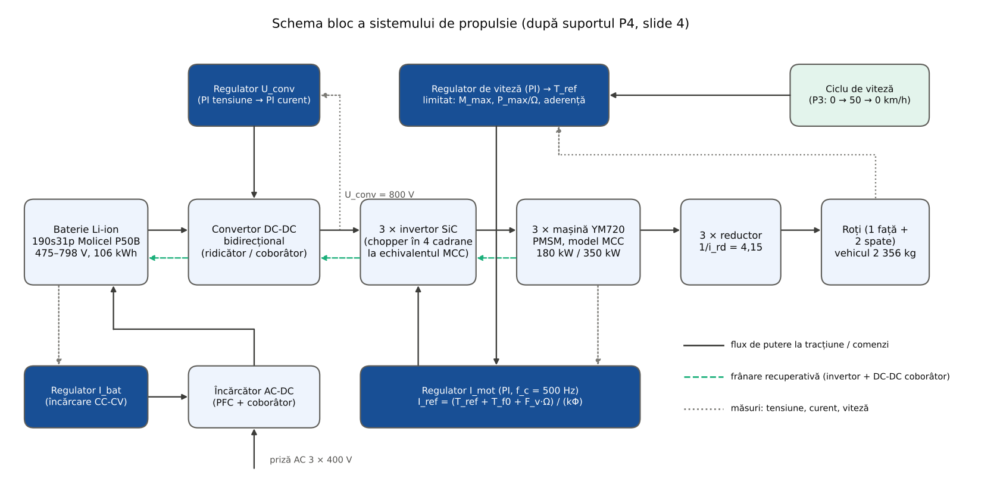
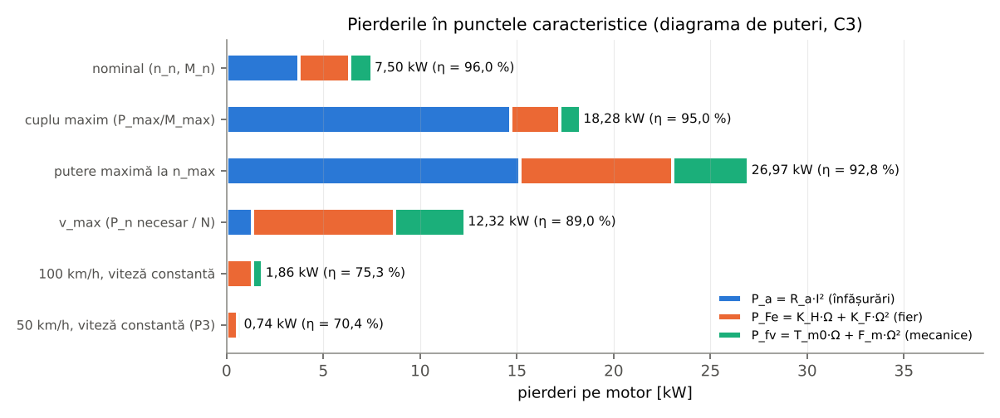
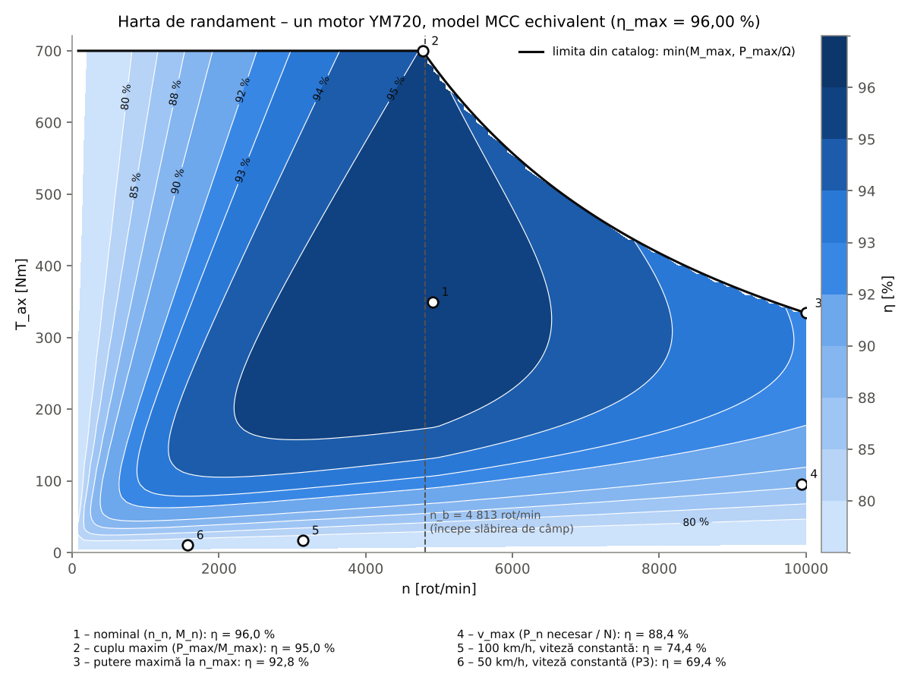
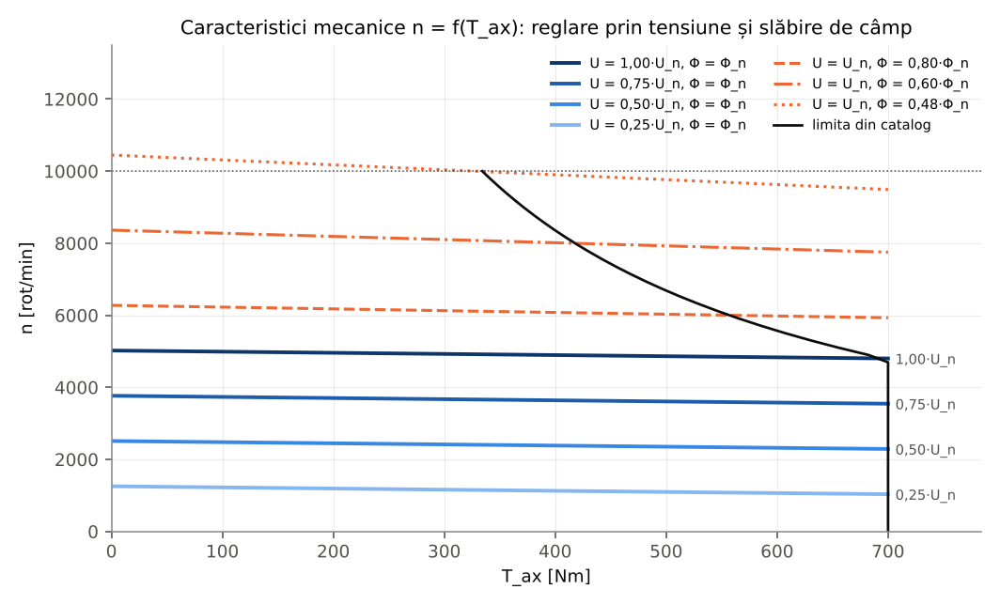
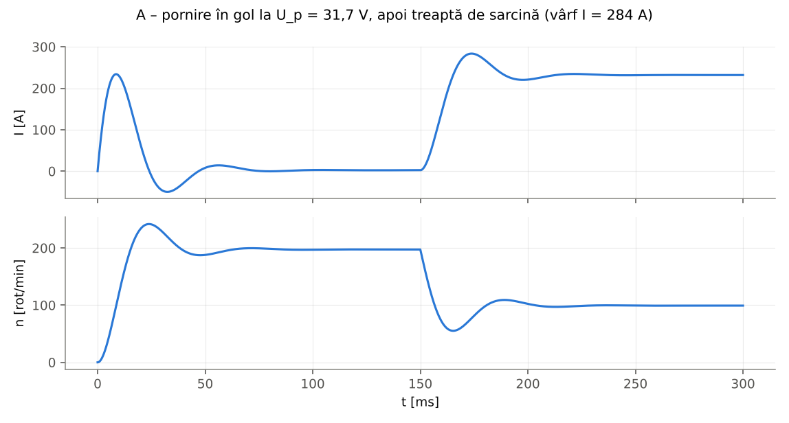
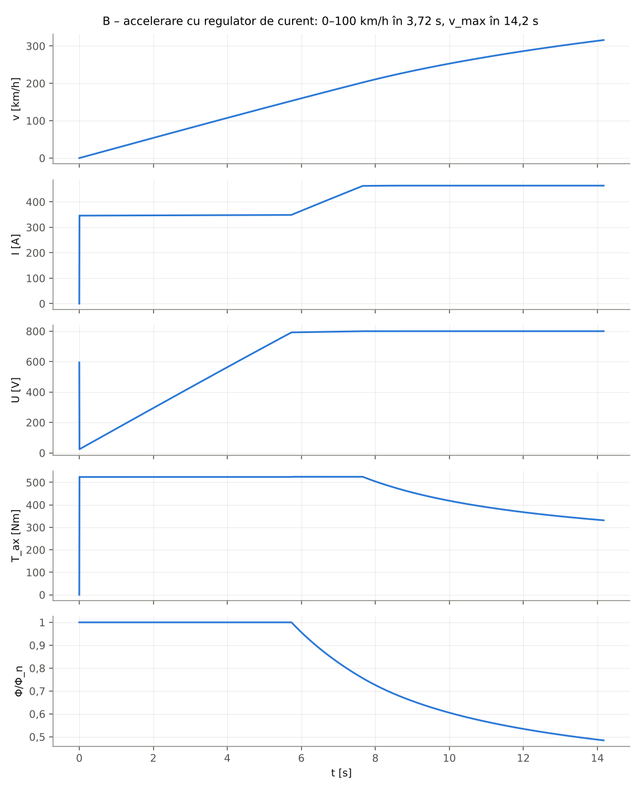
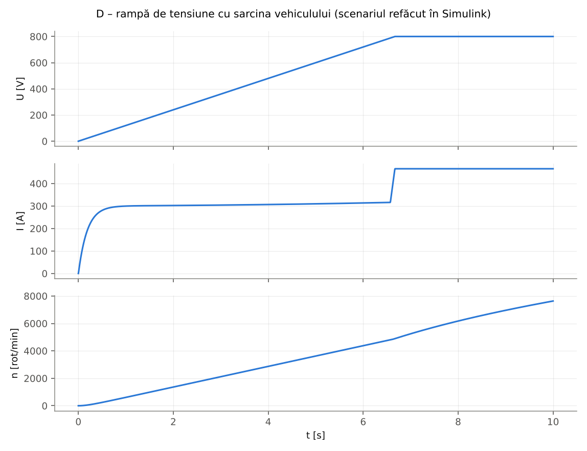
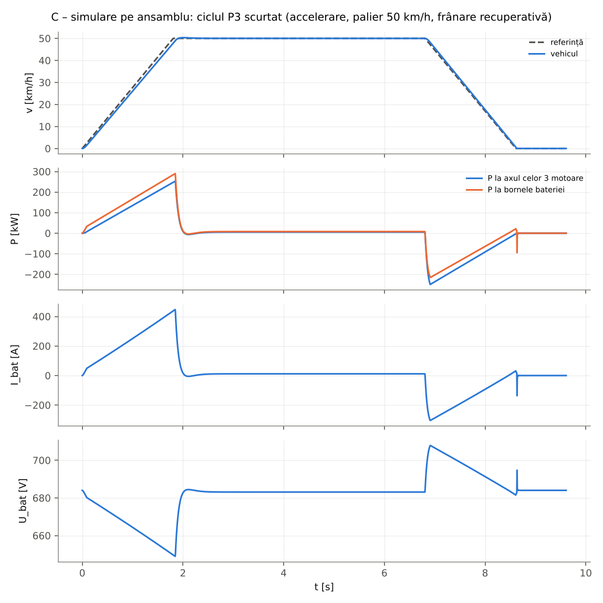

# Etapa 3 – Tema de proiect (P4) și modelul mașinii electrice (curs C3)

Calculele cerute în suportul **CCA – Proiect P4** (tema de proiect și schema bloc) și în cursul **C3 – MCC**
(ecuațiile mașinii, diagrama de puteri, pierderile de cuplu, căldura produsă, exercițiile 1 și 2):

- **P4, slide 3** – tema: mașina electrică (P_n, U_n, I_n, n, M_n, P_max, I_max, M_max), reductorul (i_rd), bateria
  (W_bat) și cerințele vehiculului (P_rn, n_rn, M_rn, P_rmax, n_rmax, M_rmax), cu **confirmările MCC / reductor /
  baterie**;
- **P4, slide 4** – schema bloc a sistemului de propulsie și simularea pe ansamblu;
- **C3, exercițiul 1** – programul Matlab de calcul al pierderilor și **hărțile de randament**;
- **C3, exercițiul 2** – modelul mașinii cu calculul cuplului la ax (aici în Matlab cu RK4, iar în Simulink în
  folderul [`../simulink`](../simulink)).

Mașina aleasă în etapa 2 este **3 × YASA YM720** (mașină sincronă cu magneți permanenți, flux axial; 1 motor pe
puntea față, 2 pe puntea spate). Comandată vectorial (i_d = 0 sub viteza de bază), o astfel de mașină se comportă ca
o **mașină de curent continuu cu excitație separată**: T = k·i_q, E = k·Ω (cuplul proporțional cu curentul, t.e.m.
proporțională cu viteza). De aceea, ca în curs, mașina este descrisă și simulată cu **ecuațiile MCC** – „echivalentul
de curent continuu” al motorului – cu slăbirea câmpului realizată de invertor peste viteza de bază.

## Fișiere

| Fișier | Conținut |
|---|---|
| [`matlab/main_tema.m`](matlab/main_tema.m) | Tema de proiect și confirmările (P4, slide 3) |
| [`matlab/main_pierderi.m`](matlab/main_pierderi.m) | C3, ex. 1: parametrii MCC, pornirea, diagrama de puteri, harta de randament, caracteristicile mecanice, încălzirea |
| [`matlab/main_simulare.m`](matlab/main_simulare.m) | C3, ex. 2 și P4: simulările A, B, D și simularea pe ansamblu C |
| [`matlab/ruleaza_tot.m`](matlab/ruleaza_tot.m) | Rulează tot fără figuri și scrie `rezultate/rezultate_matlab.json` |
| `matlab/identificare_mcc.m`, `punct_functionare.m`, `harta_randament.m`, … | Funcțiile de calcul (modelul MCC, pierderile, simulările cu RK4) |
| [`date/motor_ales.json`](date/motor_ales.json), [`date/ipoteze_masina.json`](date/ipoteze_masina.json) | Datele de catalog ale motorului și ipotezele modelului (cu sursele) |
| [`python/model_p4.py`](python/model_p4.py), [`python/calcule_p4.py`](python/calcule_p4.py) | A doua implementare (verificare), figurile și tabelele din acest README |
| [`figuri/`](figuri), [`rezultate/`](rezultate) | Graficele și rezultatele numerice (JSON) |

**Rulare Matlab:** din folderul `matlab/`: `main_tema`, `main_pierderi`, `main_simulare` (afișează rezultatele și
desenează figurile; datele etapei 2 sunt recalculate automat din `../../etapa2-calcule/matlab`). `ruleaza_tot` rulează
totul fără figuri. **Rulare Python:** `python3 etapa3-tema-motor/python/calcule_p4.py`.

**Verificare:** aceleași formule și același integrator Runge-Kutta 4 cu pas fix sunt implementate independent în
Matlab (rulat în GNU Octave 8.4) și în Python:
<!-- AUTO:comparatie -->
Implementarea Python (python/model_p4.py) refăcută independent de MATLAB/Octave: 270 mărimi comparate, 0 diferențe peste toleranța relativă 10⁻⁶.
<!-- /AUTO:comparatie -->

## 1. Tema de proiect (P4, slide 3)

Să se proiecteze un sistem de propulsie cu acționare electrică care să aibă următoarele caracteristici:

<!-- AUTO:tema -->
| Mărime | Pe motor | Total (3 motoare) | Cum s-a obținut |
|---|---|---|---|
| P_n | 180 kW | 540 kW | catalog YASA (continuu) |
| U_n | 800 V | – | tensiunea circuitului intermediar, reglată de DC-DC |
| I_n | 234,4 A | 703,1 A | echivalent MCC: P_n/(η_n·U_n), η_n = 0,960 |
| n (nominală) | 4 911 rot/min | – | n_n = P_n/M_n; n_max = 10 000 rot/min |
| M_n | 350 Nm | 1 050 Nm | catalog (continuu) |
| P_max | 350 kW | 1 050 kW | catalog (vârf 30 s) |
| I_max | 463,9 A | 1 391,7 A | echivalent MCC la M_max și n_b = 4 813 rot/min |
| M_max | 700 Nm | 2 100 Nm | catalog (vârf) |
| Reductor i_rd | 0,2410 (1:4,15) | – | ales: n motor la v_max = 9 936 rot/min ≤ n_max |
| Baterie W_bat | necesar 104,38 kWh | instalat 106,02 kWh | P3 + celula Molicel P50B, 190s31p |
<!-- /AUTO:tema -->

Sistemul trebuie să propulseze vehiculul mediu din documentare (M = 2 356 kg), cu următoarele cerințe la roți:

<!-- AUTO:vehicul -->
| Regim | P_r | n_r | M_r | Observații |
|---|---|---|---|---|
| nominal (rulare cu v_max) | 296,3 kW | 2 394 rot/min | 1 181,6 Nm | v_max = 315,9 km/h |
| maxim (accelerare la limita de aderență) | 513,6 kW | 2 394 rot/min (max.) | 6 470,9 Nm | P_rmax la 100 km/h (758 rot/min) |
<!-- /AUTO:vehicul -->

- Mărimile mașinii sunt **calculate din cerințele vehiculului** (P2: P_max = puterea la axul mașinii la 100 km/h cu
  accelerația limitată de aderență, P_n = puterea la v_max; coloana „Cerut pe motor”) și **date de producător**
  (catalogul YASA), corelate cu reductorul ales liber (turația motoarelor la v_max rămâne sub n_max = 10 000 rot/min,
  cu rezervă pentru creșterea razei roții la viteză mare). În P2 s-a folosit preliminar n_max = 15 000 rot/min;
  reductorul final este ales pentru motorul ales.
- **U_n = 800 V** este tensiunea circuitului intermediar, menținută de convertorul DC-DC bidirecțional (bateria are
  475–798 V; aproape de încărcarea completă DC-DC-ul trece în regim de trecere directă, vezi etapa 4); **I_n și I_max**
  sunt curenții echivalentului MCC (I = P1/U), calculați în § 4.
- **Limita de putere a sistemului:** bateria și DC-DC-ul sunt dimensionate pentru P_max din P2 (≈ 519 kW la axul
  motoarelor), nu pentru suma puterilor de vârf ale motoarelor (1 050 kW); de aceea comanda de cuplu este limitată și la
  P_max/(3·Ω) pe motor (§ 9–10).
- Bateria (W_bat) este cea dimensionată în P3 cu celule Molicel P50B (etapa 2).

## 2. Confirmări: MCC, reductor, baterie

<!-- AUTO:confirmari -->
| Confirmare | Condiție | Valori | Rezultat |
|---|---|---|---|
| MCC – putere maximă | N·P_max ≥ P_max necesar | 1 050 ≥ 518,8 kW | DA |
| MCC – putere nominală | N·P_n ≥ P_n necesar | 540 ≥ 299,2 kW | DA |
| MCC – cuplu puntea față | M_max ≥ f_față·M_nec | 700 ≥ 580,4 Nm (f_față = 0,368) | DA |
| MCC – cuplu puntea spate | M_max ≥ (1 − f_față)·M_nec/2 | 700 ≥ 497,3 Nm | DA |
| MCC – tensiune | U_dc,min ≤ U_conv ≤ U_dc,max | 400 ≤ 800 ≤ 800 V | DA |
| Reductor – turație | n_max ≥ n la v_max | 10 000 ≥ 9 936 rot/min | DA |
| Reductor – cuplu la roți | N·M_max·k_rd·η_rd ≥ M_rmax | 8 628 ≥ 6 471 Nm | DA |
| Baterie – energie | W instalat ≥ W necesar | 106,02 ≥ 104,38 kWh | DA |
| Baterie – curent celulă | I_celulă(P_max, U_min) ≤ 60 A | 44,0 A | DA |
| Baterie – putere | P disponibilă·η ≥ P_max | 707 ≥ 518,8 kW | DA |
<!-- /AUTO:confirmari -->

Repartiția cuplului pe punți ține cont de transferul de sarcină: la accelerare f_față = 0,5 − (a/g)·(h/L) = 0,368, la
frânare f_față = 0,5 + (a/g)·(h/L) = 0,633 (h/L = 0,17, ipotezele din etapa 2). La accelerare motorul din față și cele
din spate au rezervă de cuplu. La frânarea cu decelerația din P3, motorul din față nu poate prelua toată forța pe care o
permite aderența punții față (ar trebui ≈ 1 000 Nm), iar puntea spate este limitată de aderență: frânarea recuperativă
acoperă doar o parte din forța necesară, restul fiind preluat de frâna mecanică. În simulări cuplul este împărțit egal
între cele 3 motoare (fiecare antrenează 1/3 din vehicul); forța totală este aceeași, dar curentul real al motorului din
față la accelerare este cu ≈ 10 % mai mare.

## 3. Schema bloc (P4, slide 4)

| Bloc din schema de curs | Realizare în proiect | Unde se calculează / simulează |
|---|---|---|
| Sistem de stocare de energie | baterie Li-ion 190s31p (Molicel P50B), 475–798 V, 106 kWh | etapa 2 (P3), [`../etapa4-convertoare`](../etapa4-convertoare) |
| „Convertor DC-DC step-down” + regulator U_conv | DC-DC **bidirecțional** cu 4 faze intercalate: ridicător la tracțiune (U_conv = 800 V), coborâtor la frânare (în schema de curs: coborâtor) | etapa 4 (P5-P6) |
| Chopper / invertor + regulator I_mot | 3 invertoare SiC; la echivalentul MCC: chopper în punte H (4 cadrane), PI de curent | § 9, etapa 4, Simulink |
| Mașină electrică | 3 × YASA YM720 (model MCC echivalent) | § 4–9 |
| Reductor | 1/i_rd = 4,0, η_rd = 0,99 | § 1 |
| Roți + regulator de viteză + ciclu de viteză | ciclul P3 (0 → 50 → 0 km/h), PI de viteză | § 10, Simulink |
| Convertor frânare recuperativă | același DC-DC în regim coborâtor (nu un convertor separat) | etapa 4 |
| Convertor AC-DC încărcător + regulator I_bat | PFC trifazat + coborâtor cu histerezis, încărcare CC-CV | etapa 4 |

## 4. Modelul MCC echivalent al mașinii (C3, III–VII)

Ecuațiile din curs, pentru un motor:

- U = E + R_a·I + ΔU_p, E = k·Φ·Ω, T_E = k·Φ·I (k_E = k_M = k în unități S.I.), ΔU_p = 0 (fără perii);
- diagrama de puteri: P1 = U·I, P_a = R_a·I², P_em = E·I = T_E·Ω, P_Fe = K_H·Ω + K_F·Ω², P_fv = T_m0·Ω + F_m·Ω²,
  P2 = T_ax·Ω, η = P2 / (P1 + P_ex) cu P_ex = 0 (magneți permanenți);
- pierderile de cuplu: T_ax = T_E − T_f0 − F_v·Ω, cu T_f0 = K_H + T_m0 și F_v = K_F + F_m; J·dΩ/dt = T_ax − T_sarcină;
- slăbirea de câmp: sub viteza de bază Φ = Φ_n și tensiunea este reglată (U < U_n); când tensiunea necesară
  depășește U_n, fluxul se reduce (la PMSM prin curentul i_d), alegând cel mai mare flux k·Φ = x care satisface
  Ω·x² − (U_n − ΔU_p)·x + R_a·T_E = 0.

**Identificarea parametrilor** pornește de la punctul nominal din catalog (180 kW, 350 Nm) și de la ipotezele din
[`date/ipoteze_masina.json`](date/ipoteze_masina.json) (fiecare cu sursa):

| Ipoteză | Valoare | Sursa / justificarea |
|---|---|---|
| η_n (la P_n, n_n) | 0,96 | YASA: randament de vârf > 96 % (Installation Guide 2021); ORNL: motorul Prius 2010 – 96 % vârf |
| Împărțirea pierderilor la n_n | Cu 50 % / Fe 35 % / mecanice 15 % | în domeniul din literatură, 40–55 / 30–50 / 10–25 %: Mahmoudi et al., IEEE TIA 2017, Tab. I (43/30/24 %); Hong et al., Energies 2024 (YASA, Cu 43 %, fier și curenți turbionari 48 %) |
| P_Fe(n_max)/P_Fe(n_n) | 3,0 | tabla NO20 (Tata Hi-Lite NO20-1300H): 2,8–3,0 la inducție constantă (cu slăbire de câmp raportul real este mai mic) |
| P_fv(n_max)/P_fv(n_n) | 3,5 | rulmenți ∝ n^1,6 (modelul SKF) → 3,1; ventilație ∝ Ω³ (NASA TN D-4849); domeniu 3,1–4,7 |
| τ_a = L_a/R_a | 8 ms | YASA Y750R: L = 245 µH, R = 25 mΩ → 9,8 ms la 20 °C, ≈ 8 ms cu înfășurarea caldă; τ se păstrează la trecerea PMSM → MCC |
| J_rotor | 0,2 kg·m² | estimare (YASA nu publică inerția): scalare după EMRAX 228/268 (≈ 0,24, limită superioară) |
| c (căldura specifică medie) | 500 J/(kg·K) | NIST: Cu 385, Fe ≈ 449, Al ≈ 897; NdFeB 460 (Arnold); repartiția maselor YASA (Taran et al., 2022) + carcasă de aluminiu → 515–580; ales acoperitor 500 |

<!-- AUTO:parametri -->
| Parametru | Valoare | Relația |
|---|---|---|
| P1_n, pierderi la n_n | 187,50 kW; 7,500 kW | P1_n = P_n/η_n |
| R_a | 0,06827 Ω | R_a = 0,50·ΣP_n / I_n² |
| k = k_E = k_M | 1,52444 V·s/rad = Nm/A | k = (U_n − R_a·I_n − ΔU_p)/Ω_n |
| K_H, K_F | 2,7727 Nm; 4,5334e-03 Nm·s/rad | P_Fe = K_H·Ω + K_F·Ω², P_Fe(n_n) = 2,625 kW, P_Fe(n_max) = 3,0·P_Fe(n_n) |
| T_m0, F_m | 0,6699 Nm; 2,9508e-03 Nm·s/rad | P_fv = T_m0·Ω + F_m·Ω², P_fv(n_max) = 3,5·P_fv(n_n) |
| T_f0, F_v | 3,4426 Nm; 7,4842e-03 Nm·s/rad | T_f0 = K_H + T_m0, F_v = K_F + F_m |
| Verificare T_ax(n_n) | 350,000 Nm | k·I_n − T_f0 − F_v·Ω_n = M_n |
| Viteza de bază n_b | 4 813 rot/min | U_n = k·Ω_b + R_a·I_max |
| Pornire directă la U_n | I_p = 11 719 A, M_p = 17 865 Nm | I_p = (U_n − ΔU_p)/R_a – inadmisibil |
| Tensiunea de pornire U_p | 31,67 V | U_p = R_a·I_max + ΔU_p |
| L_a, τ_a | 546 µH; 8,00 ms | τ_a = L_a/R_a |
| J_rotor | 0,200 kg·m² | – |
<!-- /AUTO:parametri -->

Pornirea (C3, IV): la tensiunea nominală curentul de pornire ar fi I_p = U_n/R_a ≈ 11 700 A, deci pornirea se face
la tensiune redusă, dată de convertor: **U_p = R_a·I_max ≈ 32 V** limitează curentul la I_max.

## 5. Diagrama de puteri în punctele caracteristice

<!-- AUTO:puncte -->
| # | Punct de funcționare | n [rot/min] | T_ax [Nm] | Φ/Φ_n | U [V] | I [A] | P1 [kW] | P_a [kW] | P_Fe [kW] | P_fv [kW] | P2 [kW] | η [%] |
|---|---|---|---|---|---|---|---|---|---|---|---|---|
| 1 | nominal (n_n, M_n) | 4 911 | 350,0 | 1,000 | 800,0 | 234,4 | 187,50 | 3,750 | 2,625 | 1,125 | 180,00 | 96,00 |
| 2 | cuplu maxim (P_max/M_max) | 4 775 | 700,0 | 1,000 | 793,9 | 463,9 | 368,28 | 14,691 | 2,520 | 1,073 | 350,00 | 95,04 |
| 3 | putere maximă la n_max | 10 000 | 334,2 | 0,481 | 800,0 | 471,2 | 376,97 | 15,158 | 7,875 | 3,938 | 350,00 | 92,85 |
| 4 | v_max (P_n necesar / N) | 9 936 | 95,9 | 0,498 | 800,0 | 141,0 | 112,79 | 1,357 | 7,793 | 3,892 | 99,75 | 88,44 |
| 5 | 100 km/h, viteză constantă | 3 145 | 17,3 | 1,000 | 503,1 | 15,2 | 7,65 | 0,016 | 1,405 | 0,541 | 5,69 | 74,37 |
| 6 | 50 km/h, viteză constantă (P3) | 1 573 | 10,7 | 1,000 | 251,7 | 10,1 | 2,54 | 0,007 | 0,580 | 0,190 | 1,77 | 69,44 |
<!-- /AUTO:puncte -->

<!-- AUTO:puncte_text -->
<!-- /AUTO:puncte_text -->

## 6. Harta de randament (C3, exercițiul 1)

<!-- AUTO:harta -->
Randamentul maxim al modelului: **η_max = 96,00 %** la n = 4 917 rot/min, T_ax = 347 Nm; zona cu η ≥ 95 % ocupă 23,8 % din domeniul de funcționare (grilă 120 × 120).
<!-- /AUTO:harta -->

## 7. Caracteristicile mecanice n = f(T_ax)

Reglarea vitezei prin tensiune (cu flux plin, sub viteza de bază) și prin slăbirea câmpului (la U_n, peste viteza de
bază), după Ω = (U − ΔU_p)/(k_E·Φ) − R_a·I/(k_E·Φ), n = 30·Ω/π (C3, III):

## 8. Căldura produsă de pierderi (C3, VIII)

Q = m·c·ΔT, calcul adiabatic (fără răcire) pentru un motor:

<!-- AUTO:incalzire -->
Un motor: m = 33 kg, c = 500 J/(kg·K) → m·c = 16 500 J/K (fără răcire).

| Regim | Pierderi | Durată | Q | ΔT fără răcire |
|---|---|---|---|---|
| Accelerare 0–100 km/h (simularea B) | 9,05 kW (medie) | 3,72 s | 33,6 kJ | 2,04 K |
| Cuplu maxim la 4 775 rot/min (vârf din catalog) | 18,28 kW (η = 95,0 %) | 30 s | 549 kJ | 33,2 K |
| Rulare cu v_max (9 936 rot/min, 95,9 Nm) | 13,04 kW (η = 88,4 %) | 1 min | 782 kJ | 47,4 K/min |
| Ciclul P3, palier 50 km/h (1 573 rot/min, 10,7 Nm) | 777 W (η = 69,4 %) | 11,14 h | 31,2 MJ | 1 889 K (fără răcire) |
<!-- /AUTO:incalzire -->

Limitele de temperatură date de YASA (Installation Guide 2021, sec. 8.4–8.5): reducerea cuplului începe la 140 °C în
înfășurare, 100 °C în miezul statorului și 90 °C în rotor; temperatura tipică a uleiului la intrare este 65 °C.

## 9. Simulările mașinii (C3, exercițiul 2)

Modelul dinamic al unui motor care antrenează 1/3 din vehicul: J = J_rotor + M·r²/(N·k_rd²) (inerția vehiculului
raportată la ax), T_sarcină = a0 + a2·Ω² (rezistența la rulare și cea aerodinamică din P2, raportate prin reductor).
Toate simulările folosesc același integrator Runge-Kutta 4 cu pas fix (`rk4.m`).

<!-- AUTO:simulari -->
| Scenariu | Rezultat |
|---|---|
| A – pornire în gol la U_p = 31,67 V, apoi treaptă de sarcină 350 Nm la 150 ms | I de vârf 283,6 A (I_max = 463,9 A); Ω în gol 20,667 rad/s (teoretic 20,669); cu sarcină Ω = 10,390 rad/s, I = 231,9 A (teoretic 10,390 rad/s, 231,9 A) |
| B – accelerare, regulator PI de curent (500 Hz), slăbire de câmp | 0–100 km/h: **3,72 s** (P2: 3,66 s); 0–200 km/h: 7,56 s; v_max atinsă: DA în 14,2 s; I de vârf 463,9 A |
| D – rampă de tensiune 120 V/s, sarcina vehiculului | I de vârf 463,9 A; n după 10 s = 7 584 rot/min (< n_max) |
<!-- /AUTO:simulari -->

<!-- AUTO:simulari_text -->
<!-- /AUTO:simulari_text -->

## 10. Simularea pe ansamblu (P4, slide 4)

Baterie → DC-DC → 3 invertoare → 3 motoare → reductoare → roți, pe ciclul P3 scurtat, cu reglare în cascadă
(viteză → cuplu → curent) și frânare recuperativă. Convertoarele sunt reprezentate aici prin randamente constante (modele
medii). Cu comutație, DC-DC-ul și încărcătorul sunt simulate în [`../etapa4-convertoare`](../etapa4-convertoare);
chopperul (invertorul echivalent) și ansamblul cu comutație există ca modele Simulink ([`../simulink`](../simulink)),
încă nerulate în MATLAB.

<!-- AUTO:ansamblu -->
Ciclul P3 scurtat: 0 → 50 km/h în 1,81 s (a = 7,69 m/s²), palier 5 s, frânare simetrică, oprire 1 s. Regulator de viteză PI cu poli dubli la −10 rad/s (K_p = 115,7 Nm·s/rad, K_i = 578,5 Nm/rad); eroarea maximă de viteză 2,16 km/h.

| Faza | E la ax [kJ] | E la bornele motoarelor [kJ] | E în circuitul intermediar [kJ] | E din celule [kJ] | η lanț |
|---|---|---|---|---|---|
| accelerare | 219,0 | 264,0 | 268,0 | 282,9 | 0,774 |
| palier 50 km/h | 45,6 | 58,8 | 59,7 | 62,0 | 0,735 |
| frânare recuperativă | -230,9 | -187,4 | -184,5 | -176,5 | 0,764 (recuperat/ax) |

Energia luată din baterie pe ciclu: **168,4 kJ**; estimarea P3 (η = 0,8) pe același ciclu: 136,9 kJ. Curentul bateriei -304 … 447 A (max. 14,4 A pe celulă), U_bat ≥ 649 V, factorul de umplere al DC-DC ≤ 0,189.
<!-- /AUTO:ansamblu -->

<!-- AUTO:baterie_ciclu -->
<!-- /AUTO:baterie_ciclu -->

## 11. Modelele Simulink

Modelul din C3 (ecuațiile MCC cu blocuri Simulink), mașina ca bloc **DC Machine** din Specialized Power Systems,
convertoarele și sistemul complet se construiesc automat cu scripturile din [`../simulink`](../simulink) (MATLAB R2023b).

## 12. Limitările modelului

- Echivalentul MCC reproduce comportarea unui PMSM comandat vectorial (cuplu ∝ curent, t.e.m. ∝ viteză); nu modelează
  mărimile trifazate, ondulația de cuplu și pierderile suplimentare din slăbirea de câmp (i_d ≠ 0).
- Coeficienții pierderilor sunt identificați din două puncte (nominal și n_max) cu ipoteze din literatură, nu din
  măsurători pe YM720 (fișa completă YASA este disponibilă doar la cerere).
- Pierderile în fier se consideră independente de flux (forma K_H·Ω + K_F·Ω² din curs); cu slăbirea câmpului ele ar fi
  mai mici la viteze mari, deci randamentele calculate peste n_b sunt acoperitoare.
- Simulările împart cuplul egal între motoare (fiecare antrenează 1/3 din vehicul); inerția vehiculului raportată la ax
  nu include randamentul reductorului, iar inerția roților este neglijată (≈ 2 %).
- Convertoarele au randamente constante în modelul de ansamblu (pierderile la sarcină mică și la turație zero nu sunt
  modelate), deci randamentul la 50 km/h este o limită superioară.
- Curenții echivalentului MCC (de exemplu I_max ≈ 464 A) nu sunt curenții de fază ai invertorului trifazat real
  (≈ 700 A vârf la 350 kW); ondulația curentului calculată cu L_a = τ_a·R_a este și ea mai mică decât în mașina reală.
- La v_max t.e.m. corespunzătoare fluxului nominal ar fi ≈ 2·U_dc: la o oprire a invertorului la viteză mare este nevoie
  de o protecție (de exemplu scurtcircuit activ al înfășurărilor), ca tensiunea indusă să nu depășească tensiunea
  tranzistoarelor.
