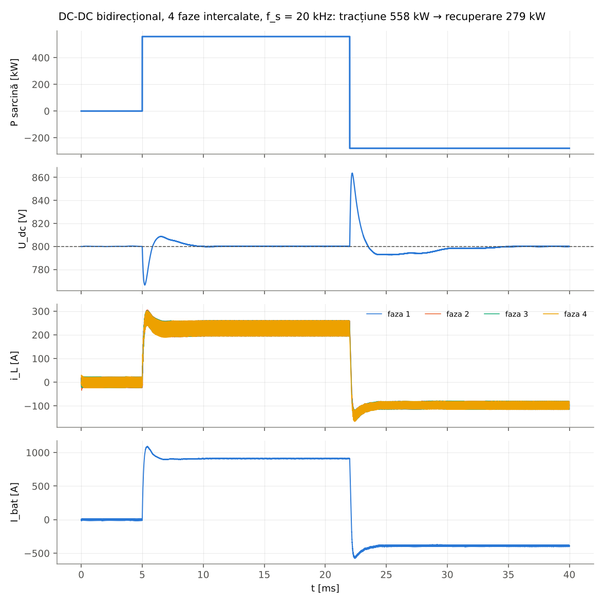
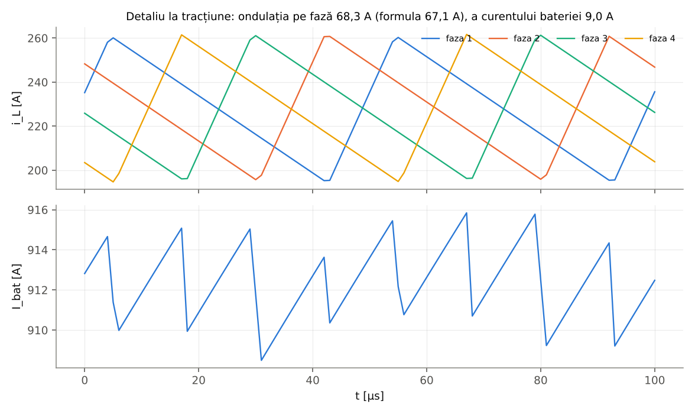
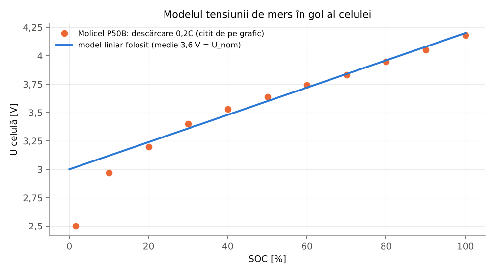
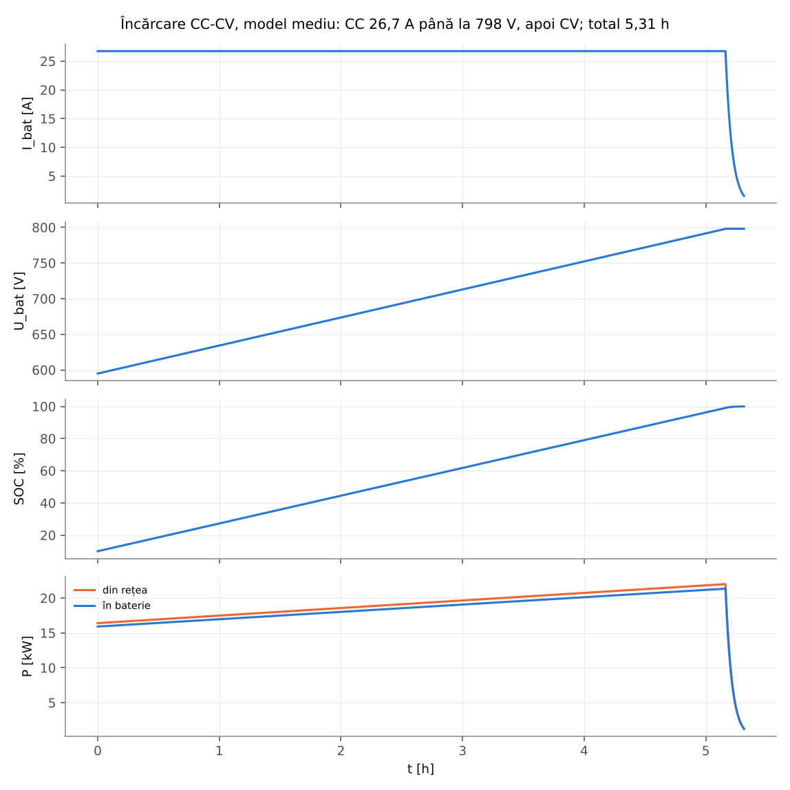
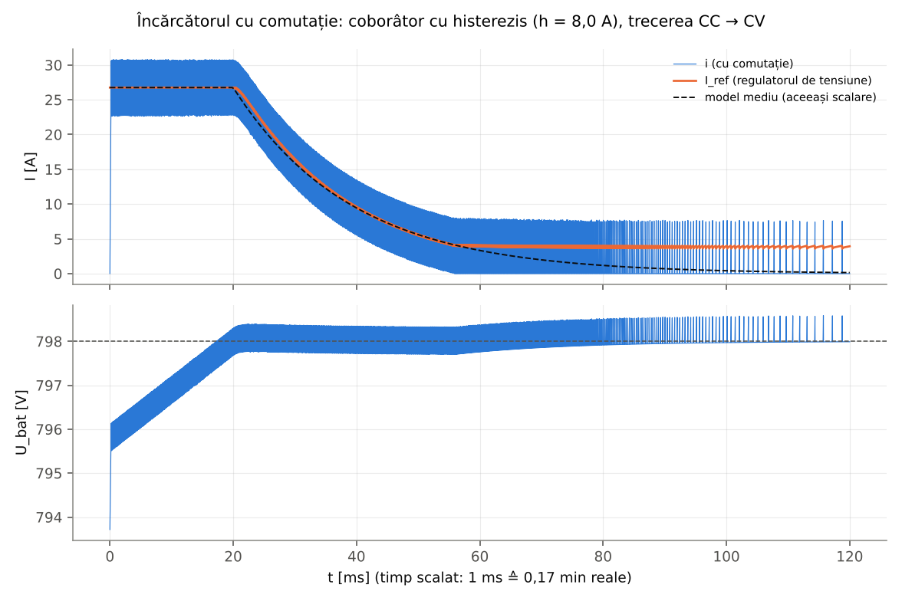

# Etapa 4 – Convertoarele DC-DC și încărcarea bateriei (Proiect P5-P6)

Suportul **CCA – Proiect P5-P6** (21.10.2026) cere, pentru fiecare bloc al schemei bloc, **calcul și simulare cu
componentele de la curs**, și o simulare pe ansamblu. Exemplele din suport sunt convertoarele DC-DC coborâtor (buck),
ridicător (boost), coborâtor-ridicător (buck-boost) și încărcarea bateriei la curent constant cu un coborâtor cu
reglare prin histerezis. Pentru sistemul de propulsie din etapa 3 acestea devin:

| Bloc | Topologie aleasă | De ce |
|---|---|---|
| Baterie ↔ circuitul intermediar | **DC-DC bidirecțional** (semipunte pe fază, 4 faze intercalate): **ridicător** la tracțiune, **coborâtor** la frânarea recuperativă | U_bat = 475–798 V, U_conv = 800 V constant pentru motoare; aceeași semipunte lucrează în ambele sensuri, deci „convertorul de frânare recuperativă” din schema de curs nu mai este un bloc separat |
| Invertorul fiecărui motor | **chopper în 4 cadrane (punte H)** – echivalentul MCC al invertorului trifazat | modelul MCC al mașinii din etapa 3 |
| Încărcătorul | redresor trifazat cu **PFC** (U_PFC = 880 V) + **coborâtor** cu reglare de curent prin **histerezis** și regulator de tensiune: încărcare **CC-CV** | ca în exemplul din suport (slide 3); U_PFC > U_CV = 798 V |

**Limitele de tensiune.** Tensiunea maximă a bateriei (798 V) este aproape egală cu U_conv = 800 V, care este și limita
superioară a domeniului de aplicare al motoarelor YASA (400–800 V). De aceea:

- la tracțiune, când U_bat > 0,95·U_conv = 760 V (baterie aproape plină), ridicătorul nu mai are rezervă de reglare și
  trece în regim de „trecere directă” (tranzistorul superior conduce permanent): U_dc este tensiunea la bornele bateriei,
  mai mică decât OCV ≤ 798 V, deci în domeniul motoarelor; în regim de reglare D ≥ 0,05;
- la frânare, cu bateria aproape plină, tensiunea la borne ar crește peste 800 V (OCV + R_bat·I): curentul de recuperare
  se limitează astfel încât U_bat ≤ 800 V (ca în vehiculele reale, frânarea recuperativă este redusă la încărcare
  completă), iar restul frânării îl preia frâna mecanică;
- coborâtorul-ridicătorul (buck-boost) din suport nu este necesar: tensiunea bateriei rămâne sub U_conv, deci la
  tracțiune tensiunea doar se ridică, iar la frânare doar se coboară. Alternativa ar fi o baterie cu mai puține celule în
  serie (de exemplu 180s, ≈ 756 V la încărcare completă), cu rezervă de tensiune, dar cu altă dimensionare în P3.

Etajul PFC al încărcătorului nu este simulat: este reprezentat printr-o sursă de c.c. de 880 V cu η_PFC = 0,985
(Wolfspeed CRD-22AD12N).

## Fișiere

| Fișier | Conținut |
|---|---|
| [`matlab/main_p5p6.m`](matlab/main_p5p6.m) | Dimensionarea și simulările (afișează rezultatele, desenează figurile) |
| [`matlab/ruleaza_tot.m`](matlab/ruleaza_tot.m) | Rulează fără figuri și scrie `rezultate/rezultate_matlab.json` |
| `matlab/dimensionare_dcdc.m`, `dimensionare_chopper.m`, `dimensionare_incarcator.m` | Calculul convertoarelor |
| `matlab/sim_dcdc_comutatie.m`, `sim_incarcare_comutatie.m`, `sim_incarcare_medie.m` | Simulările (cu comutație și model mediu) |
| [`date/convertoare.json`](date/convertoare.json) | Ipotezele de proiectare, datele componentelor alese și sursele |
| [`python/model_p5p6.py`](python/model_p5p6.py), [`python/calcule_p5p6.py`](python/calcule_p5p6.py) | A doua implementare (verificare), figurile și tabelele din acest README |
| [`figuri/`](figuri), [`rezultate/`](rezultate) | Graficele și rezultatele numerice |

**Rulare Matlab:** din folderul `matlab/`: `main_p5p6` (datele etapelor 2 și 3 se recalculează automat).
**Rulare Python:** `python3 etapa4-convertoare/python/calcule_p5p6.py`. Modelele Simulink cu componente de putere
(Specialized Power Systems) sunt în [`../simulink`](../simulink).

**Verificare:**
<!-- AUTO:comparatie -->
Implementarea Python (python/model_p5p6.py) refăcută independent de MATLAB/Octave: 125 mărimi comparate, 0 diferențe peste toleranța relativă 10⁻⁶.
<!-- /AUTO:comparatie -->
Simulările cu comutație sunt deterministe (pas fix, purtătoarea PWM calculată din numărul pasului), de aceea Matlab și
Python dau aceleași valori și pentru ele.

## 1. Convertorul DC-DC bidirecțional

Relațiile din curs / notele de aplicație TI (SLVA372D, SLVA477):

- ridicător: U_dc = U_bat/(1 − D); ΔI_L = U_bat·D/(L·f_s); C ≥ I_dc·D/(ΔU_dc·f_s);
- coborâtor (recuperare): U_bat = D_c·U_dc, D_c = 1 − D (aceeași semipunte, aceeași ondulație a curentului);
- ondulația curentului aleasă 30 % (TI: 20–40 %), a tensiunii 1 % (alegere de proiectare);
- pierderi în tranzistoare: conducție R_DS(on)·I_rms² (comandă sincronă) + comutație f_s·(E_on + E_off)
  scalate liniar cu tensiunea și curentul față de condițiile din fișa tehnică.

<!-- AUTO:dcdc -->
| Mărime | Valoare | Relația / observații |
|---|---|---|
| Punctul de dimensionare | 3 × 525,0 Nm la 3 145 rot/min | P_max (P2) la 100 km/h, η motor = 94,42 % (harta C3) |
| P în circuitul intermediar | 557,8 kW | 3·P1 / η_invertor (η = 0,985) |
| P cerută bateriei | 569,2 kW | / η_DC-DC (ipoteză 0,980) |
| U_dc / U_bat | 800 V / 475…798 V (nominal 684 V) | – |
| D ridicător | 0,0025 … 0,4062 (nominal 0,145) | D = 1 − U_bat/U_dc; peste 95 % din U_dc: trecere directă |
| D coborâtor (recuperare) | 0,594 … 0,9975 | D_c = U_bat/U_dc |
| I_bat max (U_bat = U_min) | 1 198 A | 4 faze × 299,6 A |
| Ondulația pe fază ΔI | 89,9 A (30 %) | TI SLVA372D: 20–40 % |
| Bobina pe fază L | **107,4 µH** | L = U_bat·D/(ΔI·f_s), maxim la U_bat = 475 V |
| Curentul de vârf pe fază | 344,5 A | I_faza + ΔI/2 |
| Condensatorul circuitului intermediar | **≥ 1 770 µF** (9 × 200 µF) | C = I_dc·D_max/(ΔU·f_s), ΔU = 8 V (1 %), o fază echivalentă (acoperitor) |
| Modulul | Wolfspeed CAB760M12HM3 (semipunte SiC 1200 V) | U_DS = 1200 V ≥ U_dc/0,8: DA; I_vârf ≤ 0,8·765 A: DA |
| Pierderi în tranzistoare la P_max | 2,59 kW (η = 99,54 %) | conducție 212 W + comutație 436 W pe fază |
<!-- /AUTO:dcdc -->

Componentele: modulul SiC **Wolfspeed CAB760M12HM3** (1200 V, 765 A la T_C = 90 °C, R_DS(on) = 2,34 mΩ la 175 °C,
E_on/E_off = 23,7/17,8 mJ la 600 V/760 A – fișa tehnică Rev. 5, p. 1–2) și condensatoare de circuit intermediar
**TDK B32778J0207K000** (MKP, 200 µF, 1100 V, 66 A). Frecvența de comutație de 20 kHz este o alegere de proiectare
(Wolfspeed CRD-60DD12N, un ridicător SiC intercalat 470–800 V → 850 V, lucrează la 78 kHz cu componente discrete).
Pierderile calculate (0,5 %) cuprind doar tranzistoarele, cu energiile de comutație scalate liniar cu tensiunea (în
realitate ≈ U^1,3–1,5); cu bobinele și condensatoarele randamentul real este mai mic, de aceea în calcule s-a păstrat
ipoteza η_DC-DC = 98 %, între randamentul de vârf al unui ridicător SiC intercalat (99,5 %, Wolfspeed CRD-60DD12N) și cel
al unui convertor SiC de 100 kW (97,4 %, Ni et al., IEEE TPEL 2020 – convertor cu condensatoare comutate).

Curentul maxim al bateriei (≈ 1 200 A, ≈ 39 A/celulă) este calculat aici cu randamentele motorului (harta C3),
invertorului și DC-DC-ului; în P3 și în confirmările etapei 3 s-a folosit randamentul global η = 0,8, care dă 1 365 A
(44,0 A/celulă). Ambele valori sunt sub limita celulelor (31 × 60 A = 1 860 A).

<!-- AUTO:dcdc_text -->
<!-- /AUTO:dcdc_text -->

## 2. Chopperul în 4 cadrane (invertorul echivalent)

<!-- AUTO:chopper -->
| Mărime | Valoare |
|---|---|
| f_pwm (modulație unipolară, frecvența ondulației 2·f_pwm) | 10 kHz |
| L_a (= τ_a·R_a) | 0,546 mH |
| Ondulația maximă ΔI = U_dc/(8·L_a·f_pwm) (m = 0,5) | 18,3 A (3,9 % din I_max) → ΔT = 27,9 Nm |
| Nominal / cuplu maxim / P_max la 100 km/h: m = U/U_dc | 1,000 / 0,992 / 0,657 |
| ΔI în aceste puncte | 0,0 / 0,6 / 16,5 A |
| Curentul de vârf al tranzistoarelor | 473,1 A |
<!-- /AUTO:chopper -->

f_pwm = 10 kHz: frecvența tipică a invertoarelor auto (Reiter et al., IET Power Electronics 2026 – Infineon).
Inductivitatea echivalentă L_a = τ_a·R_a (etapa 3) face ca ondulația curentului să fie mică (sub 5 % din I_max).

## 3. Încărcătorul (CC-CV)

<!-- AUTO:incarcator -->
| Mărime | Valoare | Observații |
|---|---|---|
| Rețea / putere AC | 3 × 400 V, 22 kW | încărcător de bord (mod 3, IEC 61851) |
| U_dc după PFC | 880 V | > √2·U_AC = 566 V și > U_CV: DA |
| P în baterie | 21,34 kW | η_PFC·η_coborâtor = 0,970 |
| Faza CC | 26,75 A = 0,173C (0,863 A/celulă) | I_CC = P_bat/U_CV; fișa celulei: standard 1C, maxim 5C |
| Faza CV | 798 V (4,2 V/celulă) | oprire la 1,55 A (50 mA/celulă, sursă S) |
| D coborâtor | 0,540 … 0,907 | D = U_bat/U_dc |
| Histerezis / bobină | h = 8,02 A → L = 605 µH | f = U_dc·D(1−D)/(h·L) ≤ 45 kHz |
| Baterie (model) | R = 78,5 mΩ, OCV 570…798 V, C_eq = 2 447 F, τ_CV = 192 s | OCV liniar, medie = U_nom |
| Durata (analitic) de la SOC = 10 % | CC 5,16 h + CV 9,1 min = 5,31 h | – |
<!-- /AUTO:incarcator -->

- Încărcarea standard a celulei P50B este CC-CV la 4,2 V, 5 A (1C), maxim 25 A (5C) (fișa Molicel); încărcătorul de
  bord de 22 kW (redresor activ trifazat cu PFC, tip Wolfspeed CRD-22AD12N, 650–900 V c.c.) dă doar 0,17C, deci
  ≈ 5,3 h pentru 10 → 100 %. Încărcarea rapidă în c.c. (de exemplu până la 320 kW la stațiile de 800 V, Porsche Taycan –
  Porsche Newsroom) ar ocoli încărcătorul. Cu reglare la putere constantă în locul curentului constant încărcarea ar
  fi mai scurtă (curentul ar putea fi mai mare la tensiune mică).
- În realitate etajul DC-DC al încărcătorului este izolat (rezonant CLLC); aici este simplificat la coborâtorul
  neizolat din exemplul de curs.
- Modelul bateriei: rezistența internă (12,8 mΩ/celulă, fișa Molicel) și o tensiune de mers în gol liniară în SOC,
  ca în exemplul de curs (tensiunea crește liniar la încărcarea cu curent constant). Capetele, 3,0 V și 4,2 V pe celulă,
  dau media 3,6 V = tensiunea nominală, deci energia modelului este cea a bateriei reale:

## 4. Simulări

<!-- AUTO:simulari -->
| Simulare | Rezultat | Verificare |
|---|---|---|
| Încărcare completă, model mediu (pas 1 s) | CC 5,16 h, total 5,31 h, SOC final 99,95 %; din rețea 100,22 kWh, în baterie 97,24 kWh, stocat 96,94 kWh | analitic: 5,16 h / 5,31 h |
| Încărcător cu comutație (timp scalat 1:10000) | trecere CC → CV la 20,63 ms; I la t_CC + τ = 9,93 A; f în CC = 15,2 kHz; oprire (I < 1,55 A) la 74,9 ms | model mediu: 20 ms; 9,84 A; 15,3 kHz; oprire la 74,7 ms |
| DC-DC cu comutație – tracțiune (558 kW) | I_bat = 909 A, U_bat = 612,6 V, D = 0,2344, U_dc = 800,04 V; ΔI faza 68,1 A, ΔI_bat 10,4 A, ΔU_dc 0,24 V | D = 0,2342; ΔI faza = 66,8 A; ΔU_dc ≤ 8 V |
| DC-DC cu comutație – recuperare (279 kW) | I_bat = -391 A, U_bat = 714,7 V, D = 0,1071, U_dc = 799,99 V; ΔI faza 36,8 A | D = 0,1067; ΔI faza = 35,5 A |
| DC-DC – treptele de sarcină | U_dc min 766,5 V la treapta de tracțiune, max 863,7 V la trecerea în recuperare | ±8,0 % |
<!-- /AUTO:simulari -->

Simularea cu comutație a încărcătorului folosește bateria cu capacitatea redusă de 10 000 de ori (timp scalat), ca faza
CV să se vadă în 0,12 s simulate cu pasul de 0,1 µs; comutația, banda de histerezis și curenții rămân cei reali.
Rezultatul coincide cu modelul mediu scalat la fel (trecerea CC → CV, curentul în faza CV, oprirea la I_tăiere):

La curent mic, în faza CV, banda fixă de histerezis duce la funcționare în impulsuri (conducție întreruptă); curentul
mediu urmează totuși referința, iar încărcarea se oprește la 50 mA/celulă.

## 5. Observații

- Simularea DC-DC-ului este făcută la U_bat = 684 V (nominal); cazul cel mai greu pentru curent (475 V) este acoperit de
  dimensionare, nu de simulare.
- Ondulația calculată a tensiunii pe condensator (o fază echivalentă) este acoperitoare; criteriul care contează este
  variația tensiunii la schimbările rapide de sarcină. Condensatoarele invertoarelor (400–600 µF pentru 300 kW, TDK
  xEVCap) sunt în paralel pe același circuit intermediar.
- Chopperul în punte H este calculat aici și simulat cu comutație doar în modelul Simulink de ansamblu (încă nerulat);
  curenții echivalentului MCC nu sunt curenții de fază ai invertorului trifazat real.
- Datele de catalog folosite sunt în [`date/convertoare.json`](date/convertoare.json), fiecare cu sursa.
